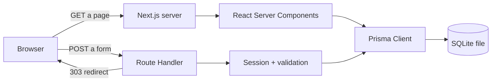
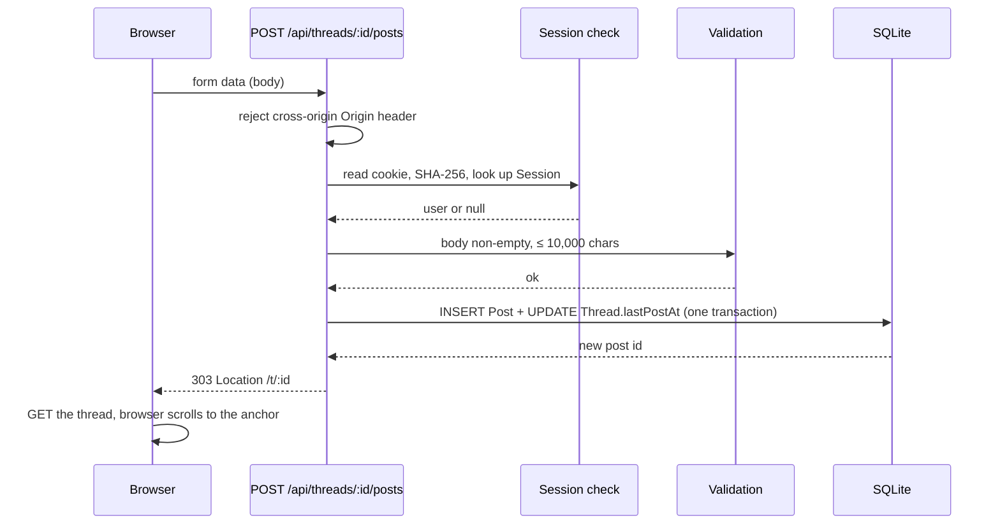

# Architecture

> 日本語版: [日本語](ja/02-architecture.md)

## 1. Shape of the system

One Next.js application, one database, no separate backend service and no external SaaS in the
MVP. The browser talks to the same origin for both pages and form submissions.



The important property: **pages read, handlers write.** A page never mutates, a handler never
renders a page. This keeps the permission checks in one place and makes every write testable
with `curl`.

## 2. Stack and why

| Layer | Choice | Why this and not the alternative |
| --- | --- | --- |
| Language | TypeScript 5 | One language on client and server; types catch the shape of posts and sessions |
| Framework | Next.js 16 (App Router) | Server rendering, routing, and form endpoints in one deployable unit; huge documentation base |
| UI | React 19 + Tailwind CSS 4 | Components map directly to "post list", "thread", "report"; utility CSS avoids a design-system dependency |
| Data access | Prisma 6 | Schema is readable documentation; migrations and typed queries; switching to PostgreSQL is a datasource change |
| Database | SQLite | Zero operations, one file, trivial backup; enough for a school of this size |
| Auth | Custom cookie sessions with `scrypt` | No third-party identity provider to approve or pay for; ~100 lines that a student can read |
| Runtime | Node.js 22 | Required by Next.js 16; built-in `node:crypto` gives us `scrypt` |

Rejected alternatives are recorded in `docs/08-decision-log.md`.

## 3. Request flows

### 3.1 Reading a thread (GET)

1. Browser requests `/t/<id>`.
2. The root layout calls `getCurrentUser()`, which reads the session cookie and looks up the
   hashed token. This opts the route into per-request rendering.
3. The thread page queries the thread, its board, and all posts in chronological order.
4. React renders HTML on the server; the browser receives a complete page.
5. No client-side fetch is required for the initial view.

### 3.2 Writing a reply (POST)



A `303 See Other` is used so that refreshing the result does not resubmit the form.

## 4. Authentication and authorization

### Sessions

- A login creates a random 32-byte token (`crypto.randomBytes(32)`).
- Only `SHA-256(token)` is stored in `Session.id`. A database leak does not hand out live
  sessions.
- The raw token lives in an `HttpOnly`, `SameSite=Lax` cookie, `Secure` in production.
- Sessions expire after 30 days. Logout deletes the row; a stolen cookie stops working.
- Passwords are hashed with `scrypt` (N=16384, r=8, p=1) and a 16-byte random salt, stored as
  `scrypt:<salt>:<key>`. Verification uses `timingSafeEqual`.

### Authorization matrix

| Action | Guest | Student | Moderator | Admin |
| --- | --- | --- | --- | --- |
| Read boards, threads, posts | ✅ | ✅ | ✅ | ✅ |
| Register / log in | ✅ | — | — | — |
| Start a thread, reply, report | ❌ | ✅ | ✅ | ✅ |
| Remove post / thread, lock thread | ❌ | ❌ | ✅ | ✅ |
| View `/moderation`, resolve reports | ❌ | ❌ | ✅ | ✅ |
| Create boards or change roles | ❌ | ❌ | ❌ | ❌ (seed / SQL only in v0.1) |

Admin and moderator currently have the same powers in code. The distinction exists so that a
future audit log and role-management screen can separate them without a data migration.

Every check is performed in the route handler with `getCurrentUser()` and `isModerator()`.
Hiding a button is a UX decision, never a security control.

### Language

The interface locale is a `locale` cookie (`en` or `ja`). Each server component reads it through
`getLocale()`, then pulls strings from a typed dictionary in `src/lib/i18n.ts`; there is no
external i18n library and no client-side translation. A `POST /api/locale` form flips the cookie
and redirects back to the page the reader came from. User content (thread titles, posts, board
names) is stored once and never translated. Dates and numbers are formatted per locale in JST.

## 5. Rendering and caching model

- Root layout reads cookies → routes are rendered per request.
- Pages that read the database also declare `export const dynamic = "force-dynamic"` for
  clarity and safety.
- There is no `fetch` cache, no ISR, and no `use cache`. Traffic is small and freshness matters
  more than a few milliseconds.
- Once traffic justifies it, the thread list can be cached with tags and invalidated on write;
  the current design is deliberately the simplest correct one.

## 6. Folder structure

```text
.
├── prisma/
│   ├── schema.prisma        # data model (source of truth)
│   └── seed.ts              # boards, demo users, sample threads
├── src/
│   ├── app/
│   │   ├── api/             # form endpoints (writes)
│   │   │   ├── auth/
│   │   │   ├── locale/
│   │   │   ├── posts/
│   │   │   ├── reports/
│   │   │   └── threads/
│   │   ├── b/[slug]/        # board page
│   │   ├── t/[id]/          # thread page
│   │   ├── login/           # auth pages
│   │   ├── register/
│   │   ├── new/             # create thread
│   │   ├── moderation/      # report queue
│   │   ├── layout.tsx
│   │   └── page.tsx
│   ├── components/          # header, footer, role chip
│   └── lib/
│       ├── auth.ts          # hashing, sessions, current user
│       ├── db.ts            # Prisma singleton
│       ├── format.ts        # JST timestamps
│       ├── http.ts          # redirects, origin check, form parsing
│       ├── i18n.ts          # locale cookie + request-scoped resolution
│       ├── locales.ts       # en/ja dictionaries and typed keys
│       ├── messages.ts      # localized error codes and notices
│       └── validation.ts    # length rules, safe redirect paths
└── docs/                    # this documentation set
```

## 7. Security posture

| Threat | Control today | Gap / next step |
| --- | --- | --- |
| XSS | No HTML rendering; React escapes text; plain-text only | Add CSP headers |
| SQL injection | Prisma parameterizes queries | — |
| CSRF | `SameSite=Lax` + `Origin` header check on every POST | Add per-form tokens if a browser edge case appears |
| Session theft | HttpOnly + Secure cookie, hashed tokens, expiry | Rotate on password change (no password change yet) |
| Brute-force login | None | Rate limit by IP + username; log failures |
| Spam / flood | None | Per-account and per-IP rate limits, new-account cooldown |
| Open redirect | `safeNextPath()` only allows same-site paths | Tests for `//evil` and absolute URLs |
| Privilege escalation | Server-side role checks on every moderation endpoint | Audit log with actor ids |
| PII leakage | Policy, no uploads, no real-name field, report button | Automated pattern warnings; moderator training |
| Dependency risk | Small dependency tree, lockfile committed | `pnpm audit` in CI; Dependabot |

## 8. Deployment options

| Option | Effort | Monthly cost | Pros | Cons |
| --- | --- | --- | --- | --- |
| **VPS + Caddy + systemd** (recommended for SQLite) | 1–2 h | ¥500–1,000 | One box, persistent disk, simple backups | You patch the OS; single point of failure |
| Vercel + Neon/Supabase Postgres | 1 h | ¥0–2,000 | Managed TLS and deploys; no server patching | SQLite becomes Postgres; connection pooling; free-tier limits |
| School server / LAN | varies | 0 | May satisfy school policy | No HTTPS by default, outages during holidays, unclear ownership |

For the MVP, use a small VPS (1 vCPU, 1–2 GB RAM) with a persistent volume, run `pnpm build` and
`pnpm start` behind Caddy, and keep the SQLite file outside the deployment directory. The full
runbook is in `docs/07-operations.md`.

## 9. Scaling triggers

Move off SQLite when any of these is true for two consecutive weeks:

- More than ~50 writes per second at peak, or visible `database is locked` errors.
- More than one application instance is required for availability.
- Backups take long enough to risk data loss.
- The school wants a managed database with point-in-time recovery.

The migration path is Prisma datasource → PostgreSQL, `prisma migrate`, and a data copy. No
application query changes are expected because the schema avoids SQLite-specific features.

## 10. What this architecture deliberately does not do

- No microservices, message queue, or Redis. A school forum does not need them.
- No SPA. Server-rendered HTML is faster on old phones and works without JavaScript.
- No real-time updates. Refreshing a thread is acceptable; websocket infrastructure is not.
- No multi-tenancy. One school, one deployment.
