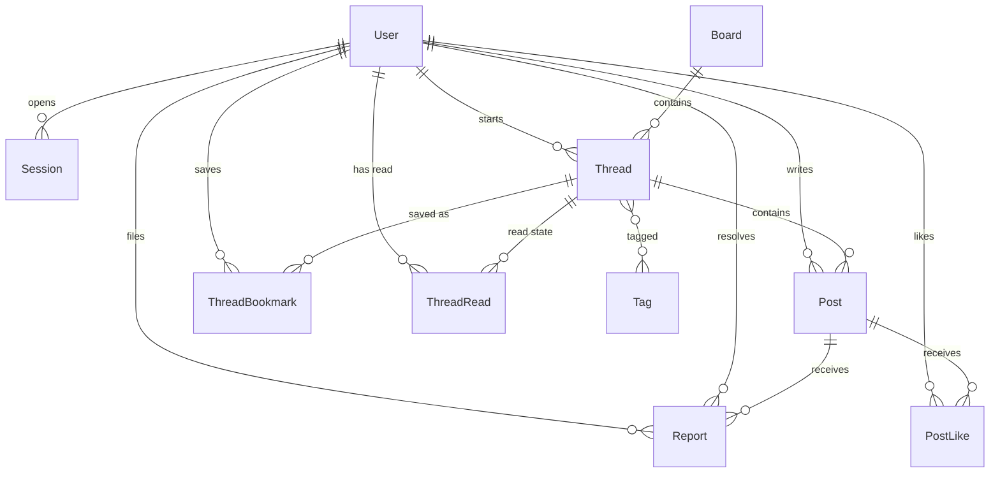

# Data Model

> 日本語版: [日本語](ja/03-data-model.md)

The schema lives in `prisma/schema.prisma` and is the source of truth. This document explains
the intent behind it.

## 1. Entity relationship diagram

## 2. Tables

### User

| Column | Type | Notes |
| --- | --- | --- |
| `id` | string (cuid) | Opaque identifier used in URLs |
| `username` | string, unique | Stored lowercase; 3–20 chars `[a-z0-9_]` |
| `email` | string?, unique | Optional; nullable uniques allow many `NULL`s in SQLite |
| `passwordHash` | string | `scrypt:<salt-hex>:<key-hex>` |
| `role` | enum | `STUDENT` (default), `MODERATOR`, `ADMIN` |
| `avatarColor` | string? | `#rrggbb` background for the avatar; `NULL` falls back to the theme palette |
| `avatarRing` | string? | `#rrggbb` ring colour; same fallback |
| `bio` | string? | ≤ 200 chars, shown on the profile page |
| `createdAt` | datetime | |

No real name, grade, class, birthday, or photo. Those fields are intentionally absent: the
cheapest way to protect personal data is not to collect it.

### Session

| Column | Type | Notes |
| --- | --- | --- |
| `id` | string (PK) | `SHA-256(token)`, never the raw token |
| `userId` | string | FK → User, cascade delete |
| `expiresAt` | datetime | 30 days after creation |
| `createdAt` | datetime | |

### Board

| Column | Type | Notes |
| --- | --- | --- |
| `id` | string (cuid) | |
| `slug` | string, unique | URL segment, e.g. `study` |
| `name` | string | Display name |
| `description` | string | One sentence shown on the board page |
| `kind` | enum | `OFFICIAL` (default) or `COMMUNITY`; drives the badge and the default ordering |
| `ownerId` | string? | FK → User for a community board; `NULL` for an official one |
| `sortOrder` | int | Lower first |
| `isArchived` | boolean | Archived boards disappear from navigation and reject new threads |
| `suggestedTags` | string | Comma-separated tag hints for the compose form, e.g. `質問,試験` |
| `createdAt` | datetime | |

### Thread

| Column | Type | Notes |
| --- | --- | --- |
| `id` | string (cuid) | |
| `boardId` | string | FK → Board |
| `authorId` | string | FK → User |
| `title` | string | 3–120 chars |
| `isPinned` | boolean | Pinned threads sort first; no pin UI in v0.1 |
| `isLocked` | boolean | Replies rejected while true |
| `isDeleted` | boolean | Soft delete; hidden from lists and thread view |
| `likeCount` | int | Likes on the opening post; denormalized |
| `bookmarkCount` | int | Bookmarks of the whole thread; denormalized |
| `createdAt` | datetime | Also the start of the 15-minute edit window |
| `lastPostAt` | datetime | Updated on each reply; drives ordering |
| `editedAt` | datetime? | Set when the author saves an edit; rendered as an "edited" marker |

### Post

| Column | Type | Notes |
| --- | --- | --- |
| `id` | string (cuid) | |
| `threadId` | string | FK → Thread |
| `parentId` | string? | FK → Post; the reply this one answers. `NULL` means it answers the thread |
| `authorId` | string | FK → User |
| `body` | string | Plain text, 1–10,000 chars |
| `isDeleted` | boolean | Soft delete; rendered as a placeholder |
| `likeCount` | int | Likes on this post; denormalized |
| `createdAt` | datetime | Chronological order |

The opening post is also a `Post` row. There is no separate `Thread.body`. This keeps rendering,
reporting, and moderation uniform: every piece of user text is one row with the same rules.

### Report

| Column | Type | Notes |
| --- | --- | --- |
| `id` | string (cuid) | |
| `reporterId` | string? | FK → User; `NULL` for automatic flags |
| `postId` | string | FK → Post; reports target posts, not threads |
| `reason` | string | 3–500 chars, shown to moderators |
| `createdAt` | datetime | |
| `resolvedAt` | datetime? | `NULL` means open |
| `resolvedById` | string? | FK → User, set on resolution |
| `resolution` | string? | `removed` or `dismissed` |
| `source` | enum | `USER` (default) or `AUTO` |

Reports are immutable history. Resolution is recorded; nothing is deleted from the queue.
Automatic flags use the same table with `source = AUTO`, no reporter, and the matched terms in
`reason`.

A partial unique index, `Report_one_open_per_reporter_post`, covers `(reporterId, postId)` where
`resolvedAt IS NULL`: one reader holds at most one open report per post, so repeated clicks do
not stack duplicates in the queue. Automatic flags have no reporter and are exempt.

### AuditLog

| Column | Type | Notes |
| --- | --- | --- |
| `id` | string (cuid) | |
| `actorId` | string? | FK → User; `NULL` if the account is deleted |
| `action` | string | `post.remove`, `thread.lock`, `thread.unlock`, `thread.remove`, `report.remove`, `report.dismiss` |
| `targetType` | string | `post`, `thread`, or `report` |
| `targetId` | string | Target row id |
| `details` | string? | Small JSON payload (thread id, board slug, report ids) |
| `createdAt` | datetime | |

Audit rows are append-only. The moderation page shows the thirty most recent ones.

### Tag

| Column | Type | Notes |
| --- | --- | --- |
| `id` | string (cuid) | |
| `name` | string, unique | NFKC-normalized, lowercased, 1–30 chars |
| `createdAt` | datetime | |

Tags are shared across threads through an implicit many-to-many table. They come from the
dedicated `tags` field on the compose and reply forms, not from hashtags in the body. The field
accepts space- or comma-separated tokens, strips a leading `#`, and keeps the first five valid
1–30 character tokens.

### ThreadLike

| Column | Type | Notes |
| --- | --- | --- |
| `userId` | string | FK → User |
| `threadId` | string | FK → Thread |
| `createdAt` | datetime | |

Composite primary key `(userId, threadId)`: one like per account and thread. The count is
denormalized into `Thread.likeCount`.

### PostLike

| Column | Type | Notes |
| --- | --- | --- |
| `userId` | string | FK → User |
| `postId` | string | FK → Post |
| `createdAt` | datetime | |

Primary key is `(userId, postId)`, so one person can like a post once.

### ThreadBookmark

| Column | Type | Notes |
| --- | --- | --- |
| `userId` | string | FK → User |
| `threadId` | string | FK → Thread |
| `createdAt` | datetime | |

Primary key is `(userId, threadId)`. The `/bookmarks` page lists these rows, newest first.

### ThreadRead

| Column | Type | Notes |
| --- | --- | --- |
| `userId` | string | FK → User |
| `threadId` | string | FK → Thread |
| `lastReadAt` | datetime | Updated when the signed-in user opens the thread |

Primary key is `(userId, threadId)`. A thread is "New" when this row is missing or
`Thread.lastPostAt` is newer than `lastReadAt`. Guests have no rows. The marker is written on
every thread view, and the feed and board lists read it to render the "新着" badge. It stores
no URLs, durations, or device information.

### RateLimit

| Column | Type | Notes |
| --- | --- | --- |
| `key` | string (PK) | Bucket identity, e.g. `login:<ip>:<username>` or `reply:<userId>` |
| `count` | int | Calls inside the current window |
| `resetAt` | datetime | When the window expires |
| `updatedAt` | datetime | Last write |

Fixed-window counters for login, registration, posting, reporting, and reactions. Keeping them
in the database means a restart does not reset an attacker's allowance and two processes on one
database share the same windows; expired rows are deleted on each login attempt.

## 3. Invariants

1. A `Thread` always has at least one `Post` at creation (nested create). It can later have all
   posts soft-deleted, but the thread row and its title remain until a moderator removes the
   thread.
2. `Thread.lastPostAt` is updated in the same transaction as a new reply. Ordering never
   depends on the latest post's `createdAt` at read time.
3. Removed content is never hard-deleted by the application. There is no purge command in
   v0.1; any retention purge must be added deliberately with a backup.
4. `Session.id` is always a hash. No code path stores a raw token.
5. Usernames are normalized to lowercase before validation and storage, so `Alice` and `alice`
   cannot both exist.
6. A resolved report has `resolvedAt`, `resolvedById`, and `resolution` set together.
7. Guests can read but cannot appear as `authorId`.
8. `Thread.likeCount` is the sum of likes on its posts. Toggling a like updates `Post.likeCount`
   and `Thread.likeCount` in the same transaction; the same rule applies to bookmarks and
   `Thread.bookmarkCount`.
9. A user has at most one like per post and one bookmark per thread. Removing the row reverses
   the counter in the same transaction.
10. Tags are normalized with NFKC and lowercased before storage. At most five tags are read
    from one write; a tag is shared by every thread that uses it. Editing a thread replaces its
    tag set in one transaction and sets `editedAt`.
11. Counters are derived data. If they ever drift, they can be rebuilt from `PostLike` and
    `ThreadBookmark` without touching user content.
12. Every moderation action writes an `AuditLog` row in the same transaction as the change. A
    missing audit row means the change did not commit.
13. An automatic flag is one `Report` with `source = AUTO`, a null reporter, and the matched
    terms. It is advisory; it never sets `isDeleted`.
14. `ThreadRead` is per user and thread and stores only a timestamp. It is written when a
    signed-in user opens the thread; there is no separate "mark all read" action.

## 4. Indexes

| Index | Purpose |
| --- | --- |
| `User.username` unique | Login lookup and duplicate prevention |
| `User.email` unique | Duplicate prevention when email is provided |
| `Session.userId` | "Delete my sessions" operations |
| `Thread(boardId, lastPostAt)` | Board thread list ordering |
| `Post(threadId, createdAt)` | Thread rendering order |
| `Thread(likeCount)` | Popularity sorting |
| `Tag.name` unique | Tag lookup from hashtags |
| `PostLike(postId)` | Counting likes for a post |
| `ThreadBookmark(threadId)` | Counting saves for a thread |
| `ThreadRead(threadId)` | Deleting a thread cascades its read rows |
| `Report(resolvedAt)` | Open-queue query |
| `AuditLog(createdAt)` | Recent moderation history |
| `AuditLog(actorId)` | Actions by one moderator |

## 5. Delete semantics

- **Post removed:** `isDeleted = true`, body stays in the database, UI shows "Removed by a
  moderator." Reports stay resolvable.
- **Thread removed:** thread `isDeleted = true`; it disappears from boards, recent activity, and
  direct links return 404. Posts remain for audit.
- **User:** not deletable from the UI. A future "delete my account" path must decide whether to
  anonymize the author or cascade content; cascading would destroy thread context.

## 6. Migration strategy

- `prisma/migrations/20261025120000_init` is the committed baseline; the development database is
  marked as already applied.
- Development: `pnpm db:migrate --name <change>` after editing the schema, then `pnpm db:deploy`
  would apply the history elsewhere. `prisma db push` is for throwaway experiments only, because
  it leaves no history.
- Deployment: `pnpm db:deploy` (`prisma migrate deploy`) builds the database from the committed
  SQL. Never run `db push` against production.
- Every migration that drops or renames a column needs a backup first and a rollback plan.
- Seed data is for development only. Production starts with boards created by an admin script
  and no demo users.

## 7. Future models (not implemented)

| Model | Why it will be needed |
| --- | --- |
| `Ban` / `Mute` | Repeat offenders; time-boxed with a reason and an expiry. |
| `EmailVerification` | Self-service verification and reset links. Requires an email provider; password reset is currently manual (`pnpm reset-password`). |
| `Notification` | Reply to my thread / mention. |
| `Attachment` | Images and files. Requires object storage, size limits, EXIF stripping, and a much stricter safety review. |
| `BoardModerator` | Per-board moderation instead of global roles. |
| `Quote` | A repost that embeds another post with commentary. |

## 8. Data retention proposal

Not yet enforced in code; agree on this before launch.

| Data | Retention | Rationale |
| --- | --- | --- |
| Active posts | Indefinite | The forum's value is persistence |
| Soft-deleted posts | 180 days, then purge body | Keeps moderation auditable without hoarding harmful text |
| Session rows | 30 days after expiry | Limit the blast radius of a database leak |
| Reports | 1 year after resolution | Pattern detection and appeals |
| AuditLog | 1 year | Accountability and incident review |
| Backups | 30 daily + 3 monthly | Recovery without unbounded storage |
