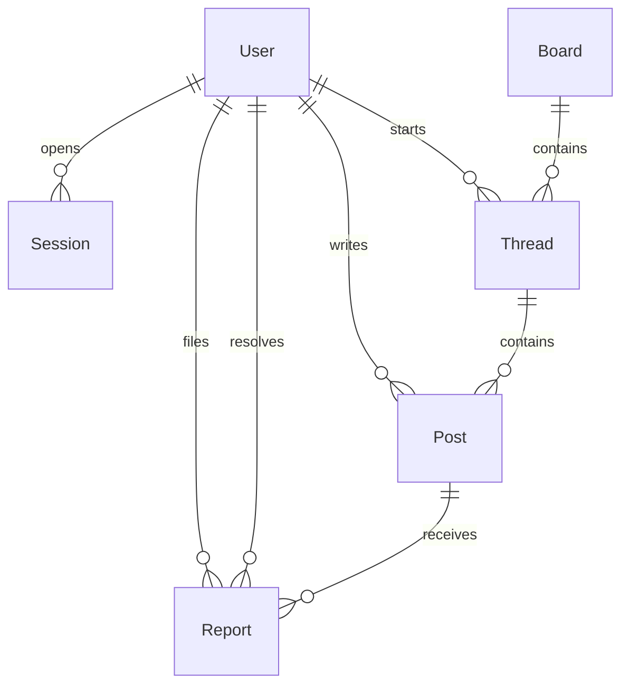

# Data Model

> 日本語版: [日本語](ja/03-data-model.md)

The schema lives in `prisma/schema.prisma` and is the source of truth. This document explains
the intent behind it.

## 1. Entity relationship diagram

## 2. Tables

### User

| Column | Type | Notes |
| --- | --- | --- |
| `id` | string (cuid) | Opaque identifier used in URLs |
| `username` | string, unique | Stored lowercase; 3–20 chars `[a-z0-9_]` |
| `email` | string?, unique | Optional; nullable uniques allow many `NULL`s in SQLite |
| `passwordHash` | string | `scrypt:<salt-hex>:<key-hex>` |
| `role` | enum | `STUDENT` (default), `MODERATOR`, `ADMIN` |
| `createdAt` | datetime | |

No real name, grade, class, birthday, or photo. Those fields are intentionally absent: the
cheapest way to protect personal data is not to collect it.

### Session

| Column | Type | Notes |
| --- | --- | --- |
| `id` | string (PK) | `SHA-256(token)`, never the raw token |
| `userId` | string | FK → User, cascade delete |
| `expiresAt` | datetime | 30 days after creation |
| `createdAt` | datetime | |

### Board

| Column | Type | Notes |
| --- | --- | --- |
| `id` | string (cuid) | |
| `slug` | string, unique | URL segment, e.g. `study` |
| `name` | string | Display name |
| `description` | string | One sentence shown on the home page |
| `sortOrder` | int | Lower first |
| `isArchived` | boolean | Archived boards disappear from navigation and reject new threads |
| `createdAt` | datetime | |

### Thread

| Column | Type | Notes |
| --- | --- | --- |
| `id` | string (cuid) | |
| `boardId` | string | FK → Board |
| `authorId` | string | FK → User |
| `title` | string | 3–120 chars |
| `isPinned` | boolean | Pinned threads sort first; no pin UI in v0.1 |
| `isLocked` | boolean | Replies rejected while true |
| `isDeleted` | boolean | Soft delete; hidden from lists and thread view |
| `createdAt` | datetime | |
| `lastPostAt` | datetime | Updated on each reply; drives ordering |

### Post

| Column | Type | Notes |
| --- | --- | --- |
| `id` | string (cuid) | |
| `threadId` | string | FK → Thread |
| `authorId` | string | FK → User |
| `body` | string | Plain text, 1–10,000 chars |
| `isDeleted` | boolean | Soft delete; rendered as a placeholder |
| `createdAt` | datetime | Chronological order |

The opening post is also a `Post` row. There is no separate `Thread.body`. This keeps rendering,
reporting, and moderation uniform: every piece of user text is one row with the same rules.

### Report

| Column | Type | Notes |
| --- | --- | --- |
| `id` | string (cuid) | |
| `reporterId` | string | FK → User |
| `postId` | string | FK → Post; reports target posts, not threads |
| `reason` | string | 3–500 chars, shown to moderators |
| `createdAt` | datetime | |
| `resolvedAt` | datetime? | `NULL` means open |
| `resolvedById` | string? | FK → User, set on resolution |
| `resolution` | string? | `removed` or `dismissed` |

Reports are immutable history. Resolution is recorded; nothing is deleted from the queue.

## 3. Invariants

1. A `Thread` always has at least one `Post` at creation (nested create). It can later have all
   posts soft-deleted, but the thread row and its title remain until a moderator removes the
   thread.
2. `Thread.lastPostAt` is updated in the same transaction as a new reply. Ordering never
   depends on the latest post's `createdAt` at read time.
3. Removed content is never hard-deleted by the application. There is no purge command in
   v0.1; any retention purge must be added deliberately with a backup.
4. `Session.id` is always a hash. No code path stores a raw token.
5. Usernames are normalized to lowercase before validation and storage, so `Alice` and `alice`
   cannot both exist.
6. A resolved report has `resolvedAt`, `resolvedById`, and `resolution` set together.
7. Guests can read but cannot appear as `authorId`.

## 4. Indexes

| Index | Purpose |
| --- | --- |
| `User.username` unique | Login lookup and duplicate prevention |
| `User.email` unique | Duplicate prevention when email is provided |
| `Session.userId` | "Delete my sessions" operations |
| `Thread(boardId, lastPostAt)` | Board thread list ordering |
| `Post(threadId, createdAt)` | Thread rendering order |
| `Report(resolvedAt)` | Open-queue query |

## 5. Delete semantics

- **Post removed:** `isDeleted = true`, body stays in the database, UI shows "Removed by a
  moderator." Reports stay resolvable.
- **Thread removed:** thread `isDeleted = true`; it disappears from boards, recent activity, and
  direct links return 404. Posts remain for audit.
- **User:** not deletable from the UI. A future "delete my account" path must decide whether to
  anonymize the author or cascade content; cascading would destroy thread context.

## 6. Migration strategy

- Development: `prisma db push` for fast iteration.
- Production: switch to `prisma migrate` **before launch**; `prisma migrate deploy` on deploy.
  Never run `db push` against production.
- Every migration that drops or renames a column needs a backup first and a rollback plan.
- Seed data is for development only. Production starts with boards created by an admin script
  and no demo users.

## 7. Future models (not implemented)

| Model | Why it will be needed |
| --- | --- |
| `AuditLog` | Who removed what, when, from which IP. Required for accountability. |
| `Ban` / `Mute` | Repeat offenders; time-boxed with a reason and an expiry. |
| `EmailVerification`, `PasswordReset` | Account recovery. Requires an email provider. |
| `Notification` | Reply to my thread / mention. |
| `Reaction` | Cheap alternative to "+1" posts. |
| `Tag` | Classify threads inside a board. |
| `Attachment` | Images and files. Requires object storage, size limits, EXIF stripping, and a much stricter safety review. |
| `BoardModerator` | Per-board moderation instead of global roles. |

## 8. Data retention proposal

Not yet enforced in code; agree on this before launch.

| Data | Retention | Rationale |
| --- | --- | --- |
| Active posts | Indefinite | The forum's value is persistence |
| Soft-deleted posts | 180 days, then purge body | Keeps moderation auditable without hoarding harmful text |
| Session rows | 30 days after expiry | Limit the blast radius of a database leak |
| Reports | 1 year after resolution | Pattern detection and appeals |
| Backups | 30 daily + 3 monthly | Recovery without unbounded storage |
