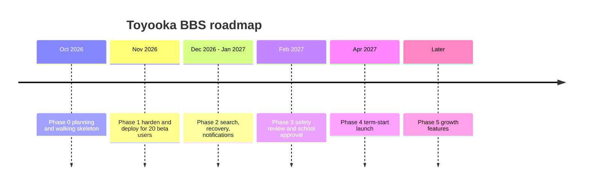

# Roadmap

> 日本語版: [日本語](ja/05-roadmap.md)

Estimates assume one developer working 8–10 hours per week and a school calendar where exam
weeks and the culture festival are unavailable. Treat them as ranges, not commitments.

## Phase 0 — Plan and build the skeleton

**Status: complete (2026-10-24).**

Deliverables:

- Product brief, scope, architecture, data model, route contract, safety plan, operations
  runbook, decision log, learning path, open questions.
- Working Next.js application: register, login, boards, threads, replies, reports, moderation,
  lock/remove, Japanese seed data, and a Japanese-first interface with an English switch.
- Public GitHub repository, MIT license, CI that builds the app.

Exit criteria: `pnpm build`, `pnpm lint`, and the end-to-end manual flow all pass.

## Phase 1 — Make it safe to open a beta (2 weeks)

**Status: in progress (2026-10-24).** The application-side work is done; deployment, the
server-side backup cron, demo-account removal, moderator briefing, and monitoring remain.

Goal: 20 invited students use the site for two weeks without a data or safety incident.

Deliverables:

1. Deploy to an HTTPS domain on a VPS with a persistent disk.
2. Daily SQLite backup to a second location; perform one restore drill.
3. Rate limiting: shipped as 10 login attempts per 10 minutes per IP+username, 60 registrations
   per hour per IP, 10 new threads per hour, 60 replies per hour, 30 reports per day, and 300
   reactions per hour. Every limit is overridable through environment variables; tune after the
   beta rather than editing code.
4. `AuditLog` table and writes for remove/lock/resolve: shipped with actor, target, and timestamp.
5. Pagination on board pages and recent activity (20 per page). **Board pagination shipped**;
   the feed shows at most 30 threads per sort and stays a reading surface rather than paging.
6. Terms of use, privacy notice, community rules, and a moderation policy page in plain English.
   **Shipped as bilingual pages** at `/terms`, `/rules`, `/privacy`, and `/moderation-policy`; the
   advisor must approve the wording.
7. A `GET /health` endpoint that checks the database connection. **Shipped 2026-10-24.**
8. Remove demo users; create a real admin account; rotate every credential.
9. Moderator briefing: what to remove, what to escalate, response times.
10. Error monitoring (Sentry free tier or a simple log drain).

Exit criteria:

- Beta participants complete a task unaided: find a board, register, post, reply, report.
- Zero open reports older than 48 hours during the beta.
- Restore drill succeeds and the recovered site serves the same thread.
- No `database is locked` errors under normal use.

Still open in Phase 1: a real HTTPS deployment, a server-side backup cron with offsite storage,
removing the demo accounts, the moderator briefing, and error monitoring.

## Phase 2 — Make it useful (3–4 weeks)

**Status: in progress (2026-10-24).**

Goal: the forum answers questions without a moderator explaining how to use it.

Deliverables:

- Upgrade the `contains` search to SQLite FTS5 when data grows or Japanese tokenization becomes a
  complaint. **Not started by design**: the current data set is small, and Japanese tokenization
  needs a trigram or a custom dictionary before FTS5 helps rather than hurts.
- Email verification and password reset, or a documented manual recovery process approved by
  the teacher advisor. **Manual recovery shipped**: `pnpm reset-password <username>` generates a
  password, prints it once, and deletes every session. The documented procedure is in
  `docs/07-operations.md`, section 8.2. Email verification remains open.
- User profile page: username, join date, recent posts (no personal data). **Shipped.**
- Unread markers or a weekly digest email. **In-app unread markers shipped**; email digest
  remains open.
- Tags per board (`question`, `event`, `lost`, `club`). **Shipped as per-board tag hints** in the
  compose and reply forms. Enforcing a fixed tag vocabulary per board is still open.
- Thread editing within a short window, with an "edited" marker. **Shipped** with a 15-minute
  window; locked and removed threads cannot be edited.
- Export a thread as plain text for printing or archiving. **Shipped** at `/t/<id>/export`.

Exit criteria:

- Search returns a relevant result for ten representative queries.
- ≥ 60% of threads receive a reply within 48 hours over a two-week window.
- Password recovery works without database access.

## Phase 3 — School approval and launch (3–4 weeks, calendar-bound)

Goal: become an accepted part of school life rather than a rogue website.

Deliverables:

- Written approval from the administration and a named teacher advisor.
- Data-handling agreement: what is stored, where, for how long, who can read it.
- Incident and escalation procedure signed by the advisor.
- Accessibility pass: keyboard navigation, focus states, contrast, screen-reader labels.
- Japanese localization of the remaining content (email templates, seed board names) if the
  school requires it; the interface is already bilingual and the documentation is complete in
  both languages.
- Load test at 3× expected peak (for example 100 concurrent readers).
- Launch plan: assembly announcement, poster with QR code, seeded "ask me anything" thread with
  teachers or club leaders.

Exit criteria:

- Approval documented and stored with the project.
- Moderators on duty for the first two weeks.
- Rollback plan tested: previous build redeployed within 15 minutes.

## Phase 4 — First term in production (ongoing)

- Weekly metrics review: registrations, weekly actives, unanswered threads, report response
  time, moderator hours.
- Monthly restore drill and dependency updates.
- Quarterly policy review with the teacher advisor.
- A visible changelog so students know why features appear or disappear.

## Phase 5 — Growth features (only with demonstrated demand)

Prioritize by observed behavior, not enthusiasm in a meeting.

| Feature | Trigger to build it |
| --- | --- |
| PWA install / offline reading | Analytics show > 70% mobile traffic and repeat visits |
| Reactions | "+1" replies exceed 10% of all posts |
| Image uploads | A club cannot run an event thread without a poster image, **and** moderation staffing can handle image review |
| Per-board moderators | One global queue exceeds 30 minutes per day |
| Public JSON API | A second client (mobile app, kiosk) is actually being built |
| Federation | Never, for a single school |

## What we deliberately postpone

- Real-time anything.
- AI moderation. It can flag, but a human decides.
- Anonymous posting. It removes accountability with no moderation benefit at this scale.
- Public sign-up from outside the school network. Open registration invites spam and strangers.

## Schedule risks

| Risk | Early warning | Response |
| --- | --- | --- |
| Exam weeks | Nobody posts | Pause feature work; do not interpret silence as failure |
| Culture festival | Traffic spike, moderation load | Freeze non-critical changes; staff the queue |
| Teacher advisor leaves | Approval at risk | Document everything; identify a second advisor early |
| Maintainer graduates | Bus factor | Recruit a successor in year 1; keep the runbook current |
| Scope creep | "Just add images" | Re-read the Won't list; images are a safety project, not a feature |
