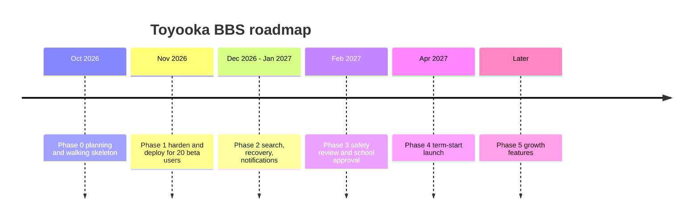

# Roadmap

> 日本語版: [日本語](ja/05-roadmap.md)

Estimates assume one developer working 8–10 hours per week and a school calendar where exam
weeks and the culture festival are unavailable. Treat them as ranges, not commitments.

## Phase 0 — Plan and build the skeleton

**Status: complete (2026-10-24).**

Deliverables:

- Product brief, scope, architecture, data model, route contract, safety plan, operations
  runbook, decision log, learning path, open questions.
- Working Next.js application: register, login, boards, threads, replies, reports, moderation,
  lock/remove, Japanese seed data, and a Japanese-first interface with an English switch.
- Public GitHub repository, MIT license, CI that builds the app.

Exit criteria: `pnpm build`, `pnpm lint`, and the end-to-end manual flow all pass.

### Delivered ahead of the roadmap (2026-10-24)

- Post likes, thread bookmarks, a saved-threads page, and a share action.
- Title/body search with newest and popularity sorting.
- Hashtag parsing, tag pages through `/search?tag=`, and tag chips on threads.
- Fixed-window rate limits on login, registration, posting, reporting, and reactions.
- Append-only audit log for moderation actions, shown on `/moderation`.
- Automatic sensitive-word flags from the CC BY 4.0 `naughty-words` lists, curated for school use.
- Tags moved to a separate compose field instead of being parsed from the body.
- These are not a substitute for the remaining Phase 1 work; they are additive.

## Phase 1 — Make it safe to open a beta (2 weeks)

Goal: 20 invited students use the site for two weeks without a data or safety incident.

Deliverables:

1. Deploy to an HTTPS domain on a VPS with a persistent disk.
2. Daily SQLite backup to a second location; perform one restore drill.
3. Rate limiting: shipped as 5 login attempts per 10 minutes per IP+username, 5 new threads per
   hour, 20 replies per hour, and 20 reports per day. Tune after the beta.
4. `AuditLog` table and writes for remove/lock/resolve: shipped with actor, target, and timestamp.
5. Pagination on board pages and recent activity (20 per page).
6. Privacy notice, community rules, and a moderation policy page in plain English.
7. A `GET /health` endpoint that checks the database connection.
8. Remove demo users; create a real admin account; rotate every credential.
9. Moderator briefing: what to remove, what to escalate, response times.
10. Error monitoring (Sentry free tier or a simple log drain).

Exit criteria:

- Beta participants complete a task unaided: find a board, register, post, reply, report.
- Zero open reports older than 48 hours during the beta.
- Restore drill succeeds and the recovered site serves the same thread.
- No `database is locked` errors under normal use.

## Phase 2 — Make it useful (3–4 weeks)

Goal: the forum answers questions without a moderator explaining how to use it.

Deliverables:

- Upgrade the `contains` search to SQLite FTS5 when data grows or Japanese tokenization becomes a complaint.
- Email verification and password reset, or a documented manual recovery process approved by
  the teacher advisor.
- User profile page: username, join date, recent posts (no personal data).
- Unread markers or a weekly digest email.
- Tags per board (`question`, `event`, `lost`, `club`).
- Thread editing within a short window, with an "edited" marker.
- Export a thread as plain text for printing or archiving.

Exit criteria:

- Search returns a relevant result for ten representative queries.
- ≥ 60% of threads receive a reply within 48 hours over a two-week window.
- Password recovery works without database access.

## Phase 3 — School approval and launch (3–4 weeks, calendar-bound)

Goal: become an accepted part of school life rather than a rogue website.

Deliverables:

- Written approval from the administration and a named teacher advisor.
- Data-handling agreement: what is stored, where, for how long, who can read it.
- Incident and escalation procedure signed by the advisor.
- Accessibility pass: keyboard navigation, focus states, contrast, screen-reader labels.
- Japanese localization of the remaining content (email templates, seed board names) if the
  school requires it; the interface is already bilingual and the documentation is complete in
  both languages.
- Load test at 3× expected peak (for example 100 concurrent readers).
- Launch plan: assembly announcement, poster with QR code, seeded "ask me anything" thread with
  teachers or club leaders.

Exit criteria:

- Approval documented and stored with the project.
- Moderators on duty for the first two weeks.
- Rollback plan tested: previous build redeployed within 15 minutes.

## Phase 4 — First term in production (ongoing)

- Weekly metrics review: registrations, weekly actives, unanswered threads, report response
  time, moderator hours.
- Monthly restore drill and dependency updates.
- Quarterly policy review with the teacher advisor.
- A visible changelog so students know why features appear or disappear.

## Phase 5 — Growth features (only with demonstrated demand)

Prioritize by observed behavior, not enthusiasm in a meeting.

| Feature | Trigger to build it |
| --- | --- |
| PWA install / offline reading | Analytics show > 70% mobile traffic and repeat visits |
| Reactions | "+1" replies exceed 10% of all posts |
| Image uploads | A club cannot run an event thread without a poster image, **and** moderation staffing can handle image review |
| Per-board moderators | One global queue exceeds 30 minutes per day |
| Public JSON API | A second client (mobile app, kiosk) is actually being built |
| Federation | Never, for a single school |

## What we deliberately postpone

- Real-time anything.
- AI moderation. It can flag, but a human decides.
- Anonymous posting. It removes accountability with no moderation benefit at this scale.
- Public sign-up from outside the school network. Open registration invites spam and strangers.

## Schedule risks

| Risk | Early warning | Response |
| --- | --- | --- |
| Exam weeks | Nobody posts | Pause feature work; do not interpret silence as failure |
| Culture festival | Traffic spike, moderation load | Freeze non-critical changes; staff the queue |
| Teacher advisor leaves | Approval at risk | Document everything; identify a second advisor early |
| Maintainer graduates | Bus factor | Recruit a successor in year 1; keep the runbook current |
| Scope creep | "Just add images" | Re-read the Won't list; images are a safety project, not a feature |
