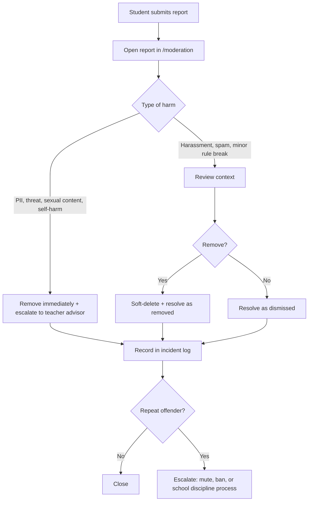

# Safety and Moderation

> This document is a working policy, not legal advice. Before launch, the teacher advisor and
> the school administration must review it. Where Japanese law is mentioned, confirm the
> current requirements with the school's legal contact.

## 1. Why this document exists

Most users are minors. A school-run forum is not a neutral side project: it carries the school's
name, it is reachable from school devices, and it can become a venue for bullying, defamation,
or the accidental publication of personal information. The default outcome of "we will moderate
it when problems appear" is a crisis.

The rule for this project: **safety features ship before growth features.**

## 2. Definitions

**Personal information (PII).** Any information that identifies a specific person, or that
combined with other available information could reasonably identify them. The test is
"reasonable identifiability", not whether a name is present.

| Is it PII? | Example | Why |
| --- | --- | --- |
| Yes | Full name, student number, class + surname | Direct identifier |
| Yes | Photo of a face, even with no name | Biometric identifier |
| Yes | Phone number, email, LINE ID, social media handle | Contact identifier |
| Yes | Home address, nearest station, daily route | Locates a person |
| Yes | "The only third-year in the photography club who drives" | Identifies by elimination |
| Usually no | Username `sakura_17` with no other data | Pseudonymous; still protected as account data |
| No | "The chemistry teacher" | Not a specific person unless the school has one |

**Moderator.** A student or staff member with the `MODERATOR` role, authorized to remove posts,
lock threads, and resolve reports.

**Teacher advisor.** A named adult employed by the school who is accountable for the site's
operation and the escalation contact for serious incidents. Required before launch.

**Removal (soft delete).** The post body stays in the database for audit, but the UI replaces it
with "Removed by a moderator." Removal is reversible by an administrator with database access.

**Escalation.** Handing a case to the teacher advisor or, for imminent danger, to the police or
emergency services.

## 3. Content policy

### Prohibited — remove on sight

1. Personal information of any student, teacher, or family member, including names, faces,
   contact details, addresses, and identifying combinations.
2. Harassment, targeted insults, or coordinated mockery of a person.
3. Defamation: statements of fact about a person that are false and damaging.
4. Threats of violence, or encouragement of self-harm or suicide.
5. Sexual content, sexualized images, or sexual comments about any person, especially minors.
6. Doxxing, stalking, or sharing someone's schedule or location.
7. Impersonation of a student, teacher, or the school.
8. Illegal activity, including drug use, weapons, and the sharing of stolen material.
9. Exam answers, leaked test papers, or content that undermines assessment integrity.
10. Spam, phishing links, malware, or advertising unrelated to school life.
11. Copyright infringement: copied articles, textbook scans, or images without permission.

### Allowed and encouraged

- Questions about coursework, with enough context to answer.
- Club announcements, event sign-ups, and reports.
- Lost and found notices without identifying details of the owner.
- Constructive feedback about the site, classes, and school events.
- Disagreement about ideas, expressed without attacking a person.
- Humor that a reasonable person in the school would not experience as harassment.

### Grey areas

Ask: *Would the person named be comfortable seeing this on the entrance notice board?* If no,
do not post it. Moderators who are unsure should leave the post up and escalate to the teacher
advisor rather than guess. Removing too much teaches students that the forum is not theirs;
removing too little creates harm.

## 4. Personal information rules for users

- Use a username, not your real name. Do not ask others for their real name.
- Do not post photos of people. Photos of buildings and events are allowed only if no face or
  name badge is visible.
- Do not post screenshots of chats, grade reports, or school systems.
- If someone posts your information, use Report; do not reply with more information.
- If you see your own information and it is urgent, contact a moderator or the teacher advisor
  directly.

## 5. Reporting and response

### Student-facing promise

> Reports are reviewed by a moderator. Most reports are handled within one school day. If you
> or someone else is in immediate danger, contact a teacher or call emergency services; this
> website is not monitored 24/7.

### Workflow

### Response targets

| Severity | Examples | Target |
| --- | --- | --- |
| Critical | Threat of violence, sexual content involving a minor, active doxxing | Immediate removal; advisor notified within 30 minutes during school hours |
| High | Personal information, targeted harassment, self-harm content | Same school day |
| Normal | Spam, rudeness, off-topic | Within 2 school days |
| Low | Disagreement about rules, feature requests | Weekly review |

### Evidence

Before removing critical content, save a screenshot or a database row reference to the incident
log. Do not forward the content to group chats; that spreads the harm. Share only with the
teacher advisor through an approved channel.

## 6. Roles and separation of duties

| Role | Can do | Cannot do |
| --- | --- | --- |
| Student | Read, post, reply, report | Moderate, see reports |
| Moderator | Remove posts/threads, lock threads, resolve reports | Change roles, read database, see another user's email |
| Admin / maintainer | Everything a moderator can, plus database access and deployment | Act without the teacher advisor on critical incidents |
| Teacher advisor | Oversight, escalation, approval of policy changes | Day-to-day queue (unless they choose to help) |

Rules:

- At least two moderators and one teacher advisor before launch.
- The maintainer must not be the only moderator. A single person with both database access and
  unchecked moderation power is an accountability hole.
- Moderators do not moderate threads they are personally involved in. Another moderator handles
  it.
- Critical decisions (ban, report to police, public statement) involve the teacher advisor.

## 7. Moderation ladder

1. **No action** — resolved as dismissed; document why if the report was made in good faith.
2. **Removal** — the default for prohibited content. The placeholder stays visible.
3. **Thread lock** — when a discussion is unproductive but the content is not removable.
4. **Mute** (future) — time-boxed, with a reason and an expiry date.
5. **Ban** (future) — requires admin + teacher advisor agreement, recorded with evidence.
6. **School process** — bullying, threats, and repeated violations go through the school's
   student guidance procedure. The website is not the disciplinary body.

Never argue with a user in a thread. State the rule once, move the discussion to a private
channel, and let the record stand.

## 8. Crisis protocol

If content suggests **imminent danger** to someone (suicide, self-harm, violence, abuse):

1. Do not try to counsel the person through the forum.
2. Notify the teacher advisor immediately by phone or in person, not only by email.
3. If the person is in immediate danger and the advisor cannot be reached, call emergency
   services (110 for police, 119 for ambulance/fire in Japan).
4. Preserve the content and metadata; do not delete it until the advisor says so.
5. Do not promise confidentiality. Say: "I am worried about you. I am going to tell a teacher
   who can help."
6. Record what happened, when, and to whom it was escalated.

A forum post is not a crisis line. Publish links to local support services on the rules page and
keep them current.

## 9. Legal context in Japan (summary, not advice)

| Law / rule | Relevance |
| --- | --- |
| Act on the Protection of Personal Information (個人情報保護法) | The school handles student data; collect the minimum, limit access, define retention, respond to disclosure requests |
| Provider Liability Limitation Act (プロバイダ責任制限法) | Defines takedown and sender-identification procedures; the operator may need a contact point and a response process |
| Penal Code Art. 230 (defamation) and Art. 231 (insult) | Posts can create criminal exposure for authors and, in some cases, for operators who fail to act |
| Copyright Act (著作権法) | Do not host scanned textbooks, manga, or copied articles |
| Act on Development of an Environment Providing Safe Internet Use for Youth | School and operator responsibilities regarding minors' internet use |
| School rules and student guidance policy | May be stricter than the law; the advisor interprets them |

Practical implications:

- Keep a documented takedown process and a named contact.
- Preserve logs long enough to respond to a lawful inquiry, but no longer than necessary.
- Do not promise anonymity you cannot deliver. Account data and server logs may be disclosable.
- For requests from police or the school, involve the teacher advisor and the administration;
  do not hand over data on your own judgment.

## 10. Data protection

- Collected: username, optional email, password hash, posts, timestamps, session hashes.
- Not collected: real name, grade, class, birthday, photos, location, IP address (not stored in
  v0.1; if added for rate limiting, document and shorten retention).
- Access: database access limited to the maintainer and, if necessary, one teacher-approved
  administrator. No shared passwords.
- Backups are encrypted at rest where the host supports it, stored separately from the server,
  and deleted on the same schedule as production data.
- Breach response: contain, assess, notify the teacher advisor and administration, reset all
  sessions, rotate credentials, and follow the school's incident procedure.

## 11. Moderator onboarding checklist

- [ ] Read this document and the community rules page.
- [ ] Understand the difference between "I dislike this" and "this violates the policy".
- [ ] Practice the queue with a test account: remove, dismiss, lock.
- [ ] Know the escalation contact and the crisis protocol.
- [ ] Agree not to share report content outside the moderation team.
- [ ] Know how to take a break. Moderators are students too.

## 12. Review

Review this policy at the start of each term and after any critical incident. Record changes in
the decision log with the date and the reason.
