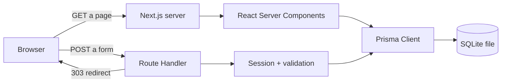
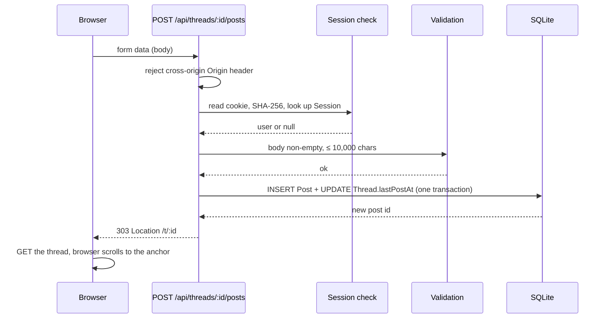

# アーキテクチャ

> 日本語版です。英語版が正本です: [English](../02-architecture.md)

## 1. システムの形

Next.js アプリケーション 1 つ、データベース 1 つ。MVP では別のバックエンドサービスも外部 SaaS も使いません。ブラウザは、ページの表示もフォームの送信も、同じオリジンとやり取りします。



ここで大事なのは **ページは読み、ハンドラーは書く** という原則です。ページがデータを変更することはなく、ハンドラーがページを描画することもありません。おかげで権限チェックを 1 か所に集められ、すべての書き込みを `curl` でテストできます。

## 2. 技術スタックと選定理由

| 層 | 選択 | なぜこれで、代替ではないのか |
| --- | --- | --- |
| 言語 | TypeScript 5 | クライアントとサーバーで同じ言語を使える。投稿やセッションの形は型が見張る |
| フレームワーク | Next.js 16（App Router） | サーバー描画、ルーティング、フォームのエンドポイントが配備 1 単位に収まる。文書も豊富 |
| UI | React 19 + Tailwind CSS 4 | コンポーネントが「投稿一覧」「スレッド」「通報」にそのまま対応する。ユーティリティ CSS なのでデザインシステムに依存しなくて済む |
| データアクセス | Prisma 6 | スキーマがそのまま読める文書になる。マイグレーションと型付きクエリが使える。PostgreSQL への切り替えは datasource の変更で済む |
| データベース | SQLite | 運用が要らない。ファイル 1 つで、バックアップも簡単。この規模の学校には十分 |
| 認証 | `scrypt` を使った独自 Cookie セッション | 承認待ちも費用も発生する外部 ID プロバイダが不要。生徒が読める約 100 行に収まる |
| 実行環境 | Node.js 22 | Next.js 16 の要件。組み込みの `node:crypto` で `scrypt` が使える |

採用しなかった代替案は `docs/ja/08-decision-log.md` に記録しています。

## 3. リクエストの流れ

### 3.1 スレッドを読む（GET）

1. ブラウザが `/t/<id>` を要求する。
2. ルートレイアウトが `getCurrentUser()` を呼び、セッション Cookie を読んで、ハッシュ化したトークンを照合する。これでこのルートはリクエストごとの描画になる。
3. スレッドページが、スレッドとそのボード、全投稿を時系列で問い合わせる。
4. React がサーバーで HTML を描画し、ブラウザは完成したページを受け取る。
5. 初回表示にクライアント側の fetch は要らない。

### 3.2 返信を書く（POST）



`303 See Other` を使うのは、結果を再読み込みしてもフォームが再送信されないようにするためです。

## 4. 認証と認可

### セッション

- ログインすると 32 バイトのランダムなトークンを作る（`crypto.randomBytes(32)`）。
- データベースの `Session.id` には `SHA-256(token)` だけを保存する。データベースが漏れても、有効なセッションをそのまま使うことはできない。
- 生のトークンは `HttpOnly`、`SameSite=Lax` の Cookie に入り、本番では `Secure` になる。
- セッションは 30 日で期限切れ。ログアウトすると行が消え、盗まれた Cookie も使えなくなる。
- パスワードは `scrypt`（N=16384、r=8、p=1）と 16 バイトのランダムな salt でハッシュ化し、`scrypt:<salt>:<key>` の形で保存する。検証には `timingSafeEqual` を使う。

### 認可マトリクス

| 操作 | ゲスト | 生徒 | モデレーター | 管理者 |
| --- | --- | --- | --- | --- |
| ボード、スレッド、投稿を読む | ✅ | ✅ | ✅ | ✅ |
| 登録／ログイン | ✅ | — | — | — |
| スレッド作成、返信、通報 | ❌ | ✅ | ✅ | ✅ |
| 投稿／スレッドの削除、スレッドのロック | ❌ | ❌ | ✅ | ✅ |
| `/moderation` の閲覧、通報の処理 | ❌ | ❌ | ✅ | ✅ |
| ボードの作成、ロールの変更 | ❌ | ❌ | ❌ | ❌（v0.1 ではシード／SQL のみ） |

いまは管理者とモデレーターの権限がコード上で同じです。それでも区別を残しているのは、将来の監査ログとロール管理画面で、データの移行なしに権限を分けられるようにするためです。

チェックはすべてルートハンドラーの中で、`getCurrentUser()` と `isModerator()` を使って行います。ボタンを隠すのは UX の判断であって、セキュリティ制御ではありません。

### 言語

画面のロケールは `locale` Cookie（`en` または `ja`）で決まります。各サーバーコンポーネントは `getLocale()` でこれを読み、`src/lib/i18n.ts` の型付き辞書から文字列を取り出します。外部の i18n ライブラリは使わず、クライアント側でも翻訳しません。`POST /api/locale` のフォームが Cookie を切り替え、読者が元いたページへリダイレクトで戻します。利用者が書いた内容（スレッドのタイトル、投稿、ボード名）は 1 回だけ保存し、翻訳しません。日付と数値はロケールに合わせて JST で整形します。

## 5. 描画とキャッシュのモデル

- ルートレイアウトが Cookie を読むので、ルートはリクエストごとに描画される。
- データベースを読むページは、分かりやすさと安全のために `export const dynamic = "force-dynamic"` も宣言している。
- `fetch` キャッシュも ISR も `use cache` も使わない。トラフィックは小さく、数ミリ秒より鮮度のほうが大事。
- トラフィックが増えて必要になれば、スレッド一覧をタグ付きでキャッシュし、書き込みのときに無効化できる。いまの設計は、意図的にいちばん単純で正しい形にしている。

## 6. フォルダ構成

```text
.
├── prisma/
│   ├── schema.prisma        # data model (source of truth)
│   └── seed.ts              # boards, demo users, sample threads
├── src/
│   ├── app/
│   │   ├── api/             # form endpoints (writes)
│   │   │   ├── auth/
│   │   │   ├── locale/
│   │   │   ├── posts/
│   │   │   ├── reports/
│   │   │   └── threads/
│   │   ├── b/[slug]/        # board page
│   │   ├── t/[id]/          # thread page
│   │   ├── login/           # auth pages
│   │   ├── register/
│   │   ├── new/             # create thread
│   │   ├── moderation/      # report queue
│   │   ├── layout.tsx
│   │   └── page.tsx
│   ├── components/          # header, footer, role chip
│   └── lib/
│       ├── auth.ts          # hashing, sessions, current user
│       ├── db.ts            # Prisma singleton
│       ├── format.ts        # JST timestamps
│       ├── http.ts          # redirects, origin check, form parsing
│       ├── i18n.ts          # locale cookie + request-scoped resolution
│       ├── locales.ts       # en/ja dictionaries and typed keys
│       ├── messages.ts      # localized error codes and notices
│       └── validation.ts    # length rules, safe redirect paths
└── docs/                    # this documentation set
```

## 7. セキュリティの現状

| 脅威 | 現在の対策 | 不足／次の一手 |
| --- | --- | --- |
| XSS | HTML を描画しない。React がテキストをエスケープする。プレーンテキストのみ | CSP ヘッダーを追加 |
| SQL インジェクション | Prisma がクエリをパラメータ化する | — |
| CSRF | `SameSite=Lax` と、すべての POST での `Origin` ヘッダー確認 | ブラウザの例外事例が出たらフォーム単位のトークンを追加 |
| セッション盗難 | HttpOnly + Secure Cookie、トークンのハッシュ化、期限 | パスワード変更時のローテーション（変更機能は未実装） |
| ログインの総当たり | なし | IP + ユーザー名単位のレート制限、失敗の記録 |
| スパム／連投 | なし | アカウント単位・IP 単位のレート制限、新規アカウントのクールダウン |
| オープンリダイレクト | `safeNextPath()` が同一サイトのパスだけを許可 | `//evil` と絶対 URL のテスト |
| 権限昇格 | すべてのモデレーション用エンドポイントでサーバー側のロール確認 | 行為者 ID 付きの監査ログ |
| 個人情報の漏えい | 方針、アップロードなし、本名欄なし、通報ボタン | パターン警告の自動化、モデレーター研修 |
| 依存関係のリスク | 依存が少なく、lockfile をコミットしている | CI での `pnpm audit`、Dependabot |

## 8. 配備の選択肢

| 選択肢 | 手間 | 月額 | 長所 | 短所 |
| --- | --- | --- | --- | --- |
| **VPS + Caddy + systemd**（SQLite 向けの推奨） | 1〜2 時間 | 500〜1,000 円 | 1 台で完結する。永続ディスクが使える。バックアップが簡単 | OS の更新は自分で行う。単一障害点になる |
| Vercel + Neon/Supabase Postgres | 1 時間 | 0〜2,000 円 | TLS と配備がマネージド。サーバーの更新が要らない | SQLite が Postgres になる。接続プーリング。無料枠の制限 |
| 学校のサーバー／LAN | 状況による | 0 円 | 学校の方針を満たせる場合がある | 既定では HTTPS がない。休暇中に止まる。所有者がはっきりしない |

MVP では、永続ボリューム付きの小さな VPS（1 vCPU、1〜2 GB RAM）を使い、Caddy の背後で `pnpm build` と `pnpm start` を実行し、SQLite ファイルは配備ディレクトリの外に置きます。詳しい手順は `docs/ja/07-operations.md` にあります。

## 9. スケールの切り替え条件

次のどれかが 2 週間続いたら、SQLite から移ります。

- ピーク時に毎秒約 50 書き込みを超える、または `database is locked` エラーが目に見える。
- 可用性のためにアプリケーションのインスタンスを 2 つ以上にする必要がある。
- バックアップに時間がかかり、データ消失の危険が出てきた。
- 学校がポイントインタイムリカバリ付きのマネージドデータベースを求める。

移行の道筋は、Prisma の datasource を PostgreSQL に変え、`prisma migrate` を実行し、データをコピーする、というものです。スキーマが SQLite 固有の機能を避けているので、アプリケーションのクエリを変更する必要はない想定です。

## 10. このアーキテクチャが意図的にやらないこと

- マイクロサービス、メッセージキュー、Redis。学校の掲示板には要りません。
- SPA。サーバー描画の HTML は古いスマートフォンで速く、JavaScript がなくても動きます。
- リアルタイム更新。スレッドを再読み込みするのは許容できますが、WebSocket の基盤は過剰です。
- マルチテナント。1 校につき 1 つの配備です。
