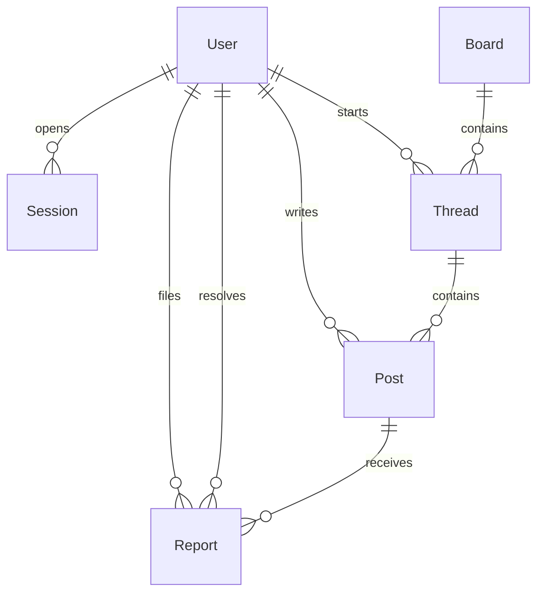

# データモデル

> 日本語版です。英語版が正本です: [English](../03-data-model.md)

スキーマは `prisma/schema.prisma` にあり、これが正本です。この文書はその意図を説明します。

## 1. エンティティ関係図

## 2. テーブル

### User

| カラム | 型 | 備考 |
| --- | --- | --- |
| `id` | string（cuid） | URL に使う不透明な識別子 |
| `username` | string、一意 | 小文字で保存。3〜20 文字 `[a-z0-9_]` |
| `email` | string?、一意 | 任意。SQLite では null 許容の一意制約により複数の `NULL` を許す |
| `passwordHash` | string | `scrypt:<salt-hex>:<key-hex>` |
| `role` | enum | `STUDENT`（既定）、`MODERATOR`、`ADMIN` |
| `createdAt` | datetime | |

本名、学年、クラス、誕生日、写真は持ちません。これらの列を意図的に置いていません。個人情報を守る最も安い方法は、最初から集めないことです。

### Session

| カラム | 型 | 備考 |
| --- | --- | --- |
| `id` | string（PK） | `SHA-256(token)`。生のトークンは保存しない |
| `userId` | string | FK → User、カスケード削除 |
| `expiresAt` | datetime | 作成から 30 日 |
| `createdAt` | datetime | |

### Board

| カラム | 型 | 備考 |
| --- | --- | --- |
| `id` | string（cuid） | |
| `slug` | string、一意 | URL の一部。例: `study` |
| `name` | string | 表示名 |
| `description` | string | ホームページに出す 1 文 |
| `sortOrder` | int | 小さい順 |
| `isArchived` | boolean | アーカイブ済みのボードはナビゲーションから消え、新規スレッドを拒否する |
| `createdAt` | datetime | |

### Thread

| カラム | 型 | 備考 |
| --- | --- | --- |
| `id` | string（cuid） | |
| `boardId` | string | FK → Board |
| `authorId` | string | FK → User |
| `title` | string | 3〜120 文字 |
| `isPinned` | boolean | 固定スレッドは先頭に並ぶ。v0.1 に固定 UI はない |
| `isLocked` | boolean | true の間は返信を拒否する |
| `isDeleted` | boolean | 論理削除。一覧とスレッド表示から隠れる |
| `createdAt` | datetime | |
| `lastPostAt` | datetime | 返信のたびに更新。並び順の基準 |

### Post

| カラム | 型 | 備考 |
| --- | --- | --- |
| `id` | string（cuid） | |
| `threadId` | string | FK → Thread |
| `authorId` | string | FK → User |
| `body` | string | プレーンテキスト、1〜10,000 文字 |
| `isDeleted` | boolean | 論理削除。プレースホルダーとして描画する |
| `createdAt` | datetime | 時系列順 |

最初の投稿も `Post` の 1 行です。`Thread.body` という別の列はありません。これにより描画、通報、モデレーションが同じ形になります。利用者が書いたテキストはすべて、同じルールを持つ 1 行です。

### Report

| カラム | 型 | 備考 |
| --- | --- | --- |
| `id` | string（cuid） | |
| `reporterId` | string | FK → User |
| `postId` | string | FK → Post。通報の対象は投稿で、スレッドではない |
| `reason` | string | 3〜500 文字。モデレーターに表示する |
| `createdAt` | datetime | |
| `resolvedAt` | datetime? | `NULL` は未処理 |
| `resolvedById` | string? | FK → User。処理時に設定 |
| `resolution` | string? | `removed` または `dismissed` |

通報は変更しない履歴です。処理は記録されますが、キューから何も削除されません。

## 3. 不変条件

1. `Thread` は作成時に必ず 1 件以上の `Post` を持つ（ネスト作成）。後からすべての投稿を論理削除することはできるが、モデレーターがスレッドを削除するまで、スレッド行とタイトルは残る。
2. `Thread.lastPostAt` は新しい返信と同じトランザクションで更新する。並び順が、読み取り時点の最新投稿の `createdAt` に依存することはない。
3. 削除された内容を、アプリケーションが物理削除することはない。v0.1 に purge コマンドはない。保存期間に基づく削除を入れるなら、バックアップとセットで意図的に追加する。
4. `Session.id` は常にハッシュ。生のトークンを保存するコード経路はない。
5. ユーザー名は検証と保存の前に小文字へ正規化する。`Alice` と `alice` が同時に存在することはできない。
6. 処理済みの通報は、`resolvedAt`、`resolvedById`、`resolution` の 3 つが同時に設定される。
7. ゲストは読めるが、`authorId` として現れることはできない。

## 4. インデックス

| インデックス | 目的 |
| --- | --- |
| `User.username` 一意 | ログイン時の照合と重複防止 |
| `User.email` 一意 | メールが指定されたときの重複防止 |
| `Session.userId` | 「自分のセッションを削除」する操作 |
| `Thread(boardId, lastPostAt)` | ボードのスレッド一覧の並び順 |
| `Post(threadId, createdAt)` | スレッドの描画順 |
| `Report(resolvedAt)` | 未処理キューの問い合わせ |

## 5. 削除の意味

- **投稿の削除:** `isDeleted = true`。本文はデータベースに残り、画面には「Removed by a moderator」と表示する。通報は引き続き処理できる。
- **スレッドの削除:** スレッドの `isDeleted = true`。ボード、最近の活動、直接リンクから消え、直接リンクは 404 になる。投稿は監査のために残る。
- **利用者:** UI からは削除できない。将来「アカウントを削除する」経路を作るときは、投稿者を匿名化するか、コンテンツをカスケード削除するかを決める必要がある。カスケード削除はスレッドの文脈を壊す。

## 6. マイグレーション方針

- 開発: 素早い反復のため `prisma db push`。
- 本番: **公開前に** `prisma migrate` へ切り替える。配備時は `prisma migrate deploy`。本番に対して `db push` を実行しない。
- カラムを削除・改名するマイグレーションの前には、必ずバックアップとロールバック計画を用意する。
- シードデータは開発専用。本番は管理者用スクリプトでボードを作り、デモ利用者を置かない状態から始める。

## 7. 将来のモデル（未実装）

| モデル | 必要になる理由 |
| --- | --- |
| `AuditLog` | 誰が、いつ、どの IP から何を削除したか。説明責任に必要。 |
| `Ban` / `Mute` | 繰り返す違反者。理由と期限を付けて期間を限定する。 |
| `EmailVerification`、`PasswordReset` | アカウント復旧。メール送信事業者が必要。 |
| `Notification` | 自分のスレッドへの返信やメンション。 |
| `Reaction` | 「+1」投稿の代わる安価な表現。 |
| `Tag` | ボード内でスレッドを分類する。 |
| `Attachment` | 画像とファイル。オブジェクトストレージ、サイズ制限、EXIF 削除、厳格な安全レビューが必要。 |
| `BoardModerator` | 全体ロールではなく、ボード単位のモデレーション。 |

## 8. データ保存期間の提案

コードではまだ強制していません。公開前に合意してください。

| データ | 保存期間 | 理由 |
| --- | --- | --- |
| 有効な投稿 | 無期限 | 掲示板の価値は内容が残ること |
| 論理削除された投稿 | 180 日後に本文を削除 | 有害なテキストを抱え込まずに、モデレーションを監査可能に保つ |
| セッション行 | 期限切れから 30 日 | データベース漏えい時の影響範囲を限定する |
| 通報 | 処理から 1 年 | パターン検出と異議申し立て |
| バックアップ | 日次 30 件 + 月次 3 件 | 無制限のストレージなしで復旧できる |
