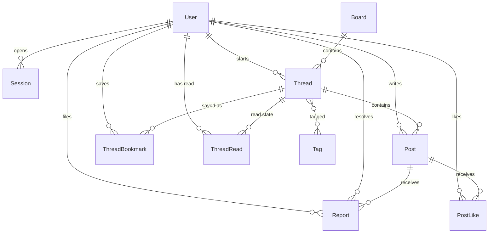

# データモデル

> 日本語版です。英語版が正本です: [English](../03-data-model.md)

スキーマの正本は `prisma/schema.prisma` です。この文書では、その設計意図を説明します。

## 1. エンティティ関係図

## 2. テーブル

### User

| カラム | 型 | 備考 |
| --- | --- | --- |
| `id` | string（cuid） | URL に使う不透明な識別子 |
| `username` | string、一意 | 小文字で保存。3〜20 文字 `[a-z0-9_]` |
| `email` | string?、一意 | 任意。SQLite では null 許容の一意制約により複数の `NULL` を許す |
| `passwordHash` | string | `scrypt:<salt-hex>:<key-hex>` |
| `role` | enum | `STUDENT`（既定）、`MODERATOR`、`ADMIN` |
| `avatarColor` | string? | アバターの背景色 `#rrggbb`。`NULL` のときはテーマの配色を使う |
| `avatarRing` | string? | アバターの縁の色 `#rrggbb`。扱いは同じ |
| `bio` | string? | 200 文字まで。プロフィールページに出す |
| `notificationsSeenAt` | datetime? | ヘッダーの通知を最後に開いた時刻。これより新しい出来事が未読になる |
| `isSuspended` | boolean | 管理画面から立てる。停止中のアカウントはログインできず、セッションはすべて削除される |
| `suspendedAt` | datetime? | 停止した時刻。解除すると消える |
| `suspendedReason` | string? | モデレーターが入力した理由（200 文字まで）。監査行にも複製する |
| `createdAt` | datetime | |

本名、学年、クラス、誕生日、写真は持ちません。これらの列は意図的に置いていません。個人情報を守るいちばん安い方法は、最初から集めないことです。

停止しても行と投稿は残ります。止まるのはログインだけです。解除すると 3 つの列を消すので、アカウントを作り直す必要はありません。

### Session

| カラム | 型 | 備考 |
| --- | --- | --- |
| `id` | string（PK） | `SHA-256(token)`。生のトークンは保存しない |
| `userId` | string | FK → User、カスケード削除 |
| `expiresAt` | datetime | 作成から 30 日 |
| `createdAt` | datetime | |

### Board

| カラム | 型 | 備考 |
| --- | --- | --- |
| `id` | string（cuid） | |
| `slug` | string、一意 | URL の一部。例: `study` |
| `name` | string | 表示名 |
| `description` | string | ボードページに出す 1 文 |
| `kind` | enum | `OFFICIAL`（既定）または `COMMUNITY`。バッジと既定の並び順を決める |
| `ownerId` | string? | コミュニティボードの持ち主 FK → User。公式ボードでは `NULL` |
| `sortOrder` | int | 値が小さい順 |
| `isArchived` | boolean | アーカイブしたボードはナビゲーションから消え、新しいスレッドも受け付けない |
| `suggestedTags` | string | 投稿フォームに出すタグのヒント。カンマ区切り（例: `質問,試験`） |
| `createdAt` | datetime | |

### Thread

| カラム | 型 | 備考 |
| --- | --- | --- |
| `id` | string（cuid） | |
| `boardId` | string | FK → Board |
| `authorId` | string | FK → User |
| `title` | string | 3〜120 文字 |
| `isPinned` | boolean | 固定したスレッドは先頭に並ぶ。v0.1 に固定用の UI はない |
| `isLocked` | boolean | true の間は返信を受け付けない |
| `isDeleted` | boolean | 論理削除。一覧にもスレッド表示にも出ない |
| `likeCount` | int | 最初の投稿へのいいね数。非正規化した値 |
| `bookmarkCount` | int | スレッド全体の保存数。非正規化した値 |
| `createdAt` | datetime | 15 分間の編集可能時間の起点でもある |
| `lastPostAt` | datetime | 返信のたびに更新。並び順を決める |
| `editedAt` | datetime? | 作成者が編集を保存したときに設定。「編集済み」の表示に使う |

### Post

| カラム | 型 | 備考 |
| --- | --- | --- |
| `id` | string（cuid） | |
| `threadId` | string | FK → Thread |
| `parentId` | string? | FK → Post。この投稿が返信している相手。`NULL` はスレッドへの返信 |
| `authorId` | string | FK → User |
| `body` | string | プレーンテキスト、1〜10,000 文字 |
| `isDeleted` | boolean | 論理削除。プレースホルダーとして描画する |
| `likeCount` | int | この投稿へのいいね数。非正規化した値 |
| `createdAt` | datetime | 時系列順 |

最初の投稿も `Post` の 1 行です。`Thread.body` という別の列はありません。こうしておくと、描画・通報・モデレーションを同じ形で扱えます。利用者が書いたテキストは、どれも同じルールを持つ 1 行になるからです。

### Report

| カラム | 型 | 備考 |
| --- | --- | --- |
| `id` | string（cuid） | |
| `reporterId` | string? | FK → User。自動フラグのときは `NULL` |
| `postId` | string | FK → Post。通報の対象は投稿で、スレッドではない |
| `reason` | string | 3〜500 文字。モデレーターに表示する |
| `createdAt` | datetime | |
| `resolvedAt` | datetime? | `NULL` は未処理 |
| `resolvedById` | string? | FK → User。処理したときに設定 |
| `resolution` | string? | `removed` または `dismissed` |
| `source` | enum | `USER`（既定）または `AUTO` |

通報は書き換えない履歴です。処理の結果は記録しますが、キューからは何も消しません。
自動フラグも同じテーブルを使い、`source = AUTO`、通報者なし、`reason` に一致した語を入れます。

部分一意インデックス `Report_one_open_per_reporter_post` が、`resolvedAt IS NULL` の `(reporterId, postId)` を覆います。1 人の利用者は 1 つの投稿に対して未処理の通報を 1 件だけ持てるので、繰り返し押してもキューに重複が積まれません。通報者のいない自動フラグは対象外です。

### AuditLog

| カラム | 型 | 備考 |
| --- | --- | --- |
| `id` | string（cuid） | |
| `actorId` | string? | FK → User。アカウント削除時は `NULL` |
| `action` | string | `post.remove`、`thread.lock`、`thread.unlock`、`thread.remove`、`report.remove`、`report.dismiss` |
| `targetType` | string | `post`、`thread`、`report` |
| `targetId` | string | 対象の行 ID |
| `details` | string? | 小さな JSON（スレッド ID、ボード slug、通報 ID） |
| `createdAt` | datetime | |

監査行は追記のみです。モデレーションページには直近 30 件を表示します。

### Tag

| カラム | 型 | 備考 |
| --- | --- | --- |
| `id` | string（cuid） | |
| `name` | string、一意 | NFKC 正規化して小文字にした 1〜30 文字 |
| `createdAt` | datetime | |

タグは暗黙の多対多テーブルでスレッド間で共有します。投稿・返信フォームの専用タグ欄から作られ、本文の `#` はタグになりません。スペースかカンマ区切りで、先頭の `#` は任意、1〜30 文字の有効な語を最大 5 個まで受け付けます。

### ThreadLike

| カラム | 型 | 備考 |
| --- | --- | --- |
| `userId` | string | FK → User |
| `threadId` | string | FK → Thread |
| `createdAt` | datetime | |

主キーは `(userId, threadId)`。1 アカウント 1 スレッドにつき 1 つだけ持ちます。件数は `Thread.likeCount` に非正規化して保存します。

### PostLike

| カラム | 型 | 備考 |
| --- | --- | --- |
| `userId` | string | FK → User |
| `postId` | string | FK → Post |
| `createdAt` | datetime | |

主キーは `(userId, postId)` です。1 人が同じ投稿に何度もいいねすることはできません。

### ThreadBookmark

| カラム | 型 | 備考 |
| --- | --- | --- |
| `userId` | string | FK → User |
| `threadId` | string | FK → Thread |
| `createdAt` | datetime | |

主キーは `(userId, threadId)` です。`/bookmarks` はこの行を新しい順に並べたものです。

### ThreadRead

| カラム | 型 | 備考 |
| --- | --- | --- |
| `userId` | string | FK → User |
| `threadId` | string | FK → Thread |
| `lastReadAt` | datetime | ログイン中の利用者がスレッドを開いたときに更新する |

主キーは `(userId, threadId)` です。この行がないとき、または `Thread.lastPostAt` が `lastReadAt` より新しいときが「新着」に当たります。記録はスレッドを開いたときに書き、フィードとボードの一覧がそれを読んで「新着」バッジを出します。ゲストは行を持ちません。URL、滞在時間、端末の情報は保存しません。

### 通知

通知のテーブルはありません。受信箱は既にある行から組み立てます。`Post`（自分の投稿への返信、自分のスレッドへの新規投稿）、`PostLike`、`ThreadLike`、`ThreadBookmark` です。それぞれ直近の行だけを取り、統合して 12 件に切るので、保存する状態は `User.notificationsSeenAt` だけで足ります。投稿を削除すれば通知も消えます。何も複製していないからです。

### RateLimit

| カラム | 型 | 備考 |
| --- | --- | --- |
| `key` | string（PK） | バケットの識別子。例: `login:<ip>:<username>`、`reply:<userId>` |
| `count` | int | 現在のウィンドウ内の回数 |
| `resetAt` | datetime | ウィンドウが切れる時刻 |
| `updatedAt` | datetime | 最後の書き込み |

ログイン、登録、投稿、通報、リアクションの固定ウィンドウのカウンターです。データベースに置くことで、再起動しても攻撃者の枠が戻らず、同じデータベースを使う 2 つのプロセスが同じウィンドウを共有します。期限切れの行はログインのたびに消します。

## 3. 不変条件

1. `Thread` は作成時に必ず 1 件以上の `Post` を持ちます（ネスト作成）。後からすべての投稿を論理削除することはできますが、モデレーターがスレッドを削除するまで、スレッドの行とタイトルは残ります。
2. `Thread.lastPostAt` は、新しい返信と同じトランザクションで更新します。並び順が、読み取り時点の最新投稿の `createdAt` に左右されることはありません。
3. 削除した内容を、アプリケーションが物理削除することはありません。v0.1 に purge コマンドはありません。保存期間に応じた削除を入れる場合は、バックアップとセットで意図的に追加してください。
4. `Session.id` は常にハッシュです。生のトークンを保存するコード経路はありません。
5. ユーザー名は検証と保存の前に小文字へ正規化します。そのため `Alice` と `alice` は共存できません。
6. 処理済みの通報には、`resolvedAt`、`resolvedById`、`resolution` の 3 つが同時に設定されます。
7. ゲストは読めますが、`authorId` として現れることはありません。
8. `Thread.likeCount` は、そのスレッドの投稿に付いたいいねの合計です。いいねを切り替えるときは、`Post.likeCount` と `Thread.likeCount` を同じトランザクションで更新します。保存と `Thread.bookmarkCount` も同じルールです。
9. 1 人が同じ投稿に付けるいいねは 1 つ、同じスレッドに付ける保存も 1 つまでです。行を消すときは、同じトランザクションで件数を戻します。
10. タグは保存前に NFKC で正規化し、小文字にします。1 回の書き込みから最大 5 個まで拾い、同じタグは使ったスレッドすべてで共有します。スレッドを編集すると、タグ一式を同じトランザクションで置き換え、`editedAt` を設定します。
11. 件数は派生データです。ずれたとしても、`PostLike` と `ThreadBookmark` から作り直せます。利用者が書いた内容には触れません。
12. モデレーション操作は、変更と同じトランザクションで `AuditLog` を 1 行書きます。監査行がなければ、その変更はコミットされていません。
13. 自動フラグは `source = AUTO`、通報者 `NULL`、一致語入りの `reason` を持つ `Report` です。助言であり、`isDeleted` を立てることはありません。
14. `ThreadRead` は利用者とスレッドの組ごとに 1 行で、時刻だけを保存します。ログイン中の利用者がスレッドを開いたときに書き込み、一括で既読にする操作はありません。

## 4. インデックス

| インデックス | 目的 |
| --- | --- |
| `User.username` 一意 | ログイン時の照合と重複防止 |
| `User.email` 一意 | メールアドレスが指定されたときの重複防止 |
| `Session.userId` | 「自分のセッションを削除」する操作 |
| `Thread(boardId, lastPostAt)` | ボードのスレッド一覧の並び順 |
| `Post(threadId, createdAt)` | スレッドの描画順 |
| `Thread(likeCount)` | 人気順の並べ替え |
| `Tag.name` 一意 | ハッシュタグからのタグ照合 |
| `PostLike(postId)` | 投稿ごのいいね集計 |
| `ThreadBookmark(threadId)` | スレッドごの保存集計 |
| `ThreadRead(threadId)` | スレッド削除時に既読行をカスケード削除する |
| `Report(resolvedAt)` | 未処理キューの問い合わせ |
| `AuditLog(createdAt)` | 最近のモデレーション履歴 |
| `AuditLog(actorId)` | 特定のモデレーターの操作 |

## 5. 削除の意味

- **投稿の削除:** `isDeleted = true` にします。本文はデータベースに残り、画面には「モデレーターが削除しました」というプレースホルダーを出します。通報は引き続き処理できます。
- **スレッドの削除:** スレッドの `isDeleted = true` を立てます。ボードからも最近の活動からも消え、直接リンクは 404 を返します。投稿は監査のために残します。
- **利用者:** UI からは削除できません。将来「アカウントを削除する」経路を作るときは、投稿者を匿名化するか、コンテンツをまとめて削除するかを決める必要があります。まとめて削除すると、スレッドの文脈が壊れます。

## 6. マイグレーション方針

- `prisma/migrations/20261025120000_init` がコミット済みの起点です。開発用のデータベースは適用済みとして記録してあります。
- 開発: スキーマを直したら `pnpm db:migrate --name <change>` でマイグレーションを作ります。他の環境には `pnpm db:deploy` で履歴ごと適用します。`prisma db push` は履歴を残さないため、使い捨ての実験だけに使います。
- 配備: `pnpm db:deploy`（`prisma migrate deploy`）で、コミットした SQL からデータベースを作ります。本番に対して `db push` は実行しないでください。
- カラムの削除や改名を含むマイグレーションでは、必ず先にバックアップを取り、ロールバック手順を用意します。
- シードデータは開発専用です。本番は、管理者用スクリプトでボードを作り、デモ利用者のいない状態から始めます。

## 7. 将来のモデル（未実装）

| モデル | 必要になる理由 |
| --- | --- |
| `Ban` / `Mute` | 繰り返し違反する利用者への対応。理由と期限を付けて期間を区切る |
| `EmailVerification` | 利用者自身による確認と再設定リンク。メール送信事業者が必要。パスワードの再設定はいまは手作業（`pnpm reset-password`） |
| `Notification` | 自分のスレッドへの返信やメンションの通知 |
| `Attachment` | 画像とファイル。オブジェクトストレージ、サイズ制限、EXIF の削除、より厳しい安全レビューが必要 |
| `BoardModerator` | 全体ロールではなく、ボード単位のモデレーション |
| `Quote` | 引用付きの転載（引用投稿） |

## 8. データ保存期間の提案

コードではまだ強制していません。公開前に合意してください。

| データ | 保存期間 | 理由 |
| --- | --- | --- |
| 有効な投稿 | 無期限 | 掲示板の価値は内容が残ること |
| 論理削除された投稿 | 180 日後に本文を削除 | 有害なテキストを抱え込まずに、モデレーションを監査可能に保つ |
| セッション行 | 期限切れから 30 日 | データベースが漏えいしたときの影響範囲を限定する |
| 通報 | 処理から 1 年 | パターンの検出と異議申し立て |
| 監査ログ | 1 年間 | 説明責任と事故調査 |
| バックアップ | 日次 30 件 + 月次 3 件 | ストレージを無制限にせずに復旧できる |
