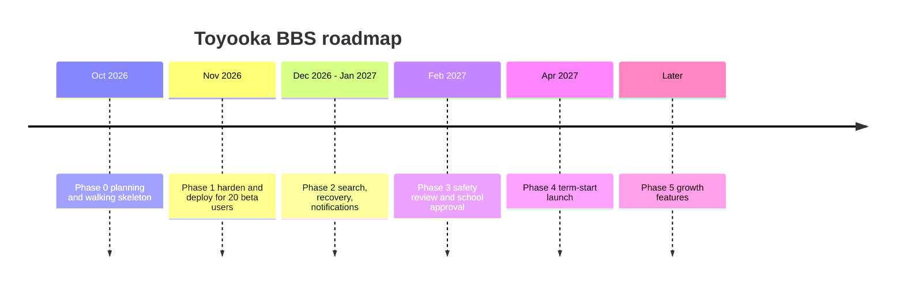

# ロードマップ

> 日本語版です。英語版が正本です: [English](../05-roadmap.md)

見積もりは、開発者 1 人が週 8〜10 時間作業し、試験週間と文化祭には動けないという前提に立ちます。幅のある目安として扱い、約束とは考えないでください。

## フェーズ 0 — 計画と骨格の構築

**状態: 完了（2026-10-24）。**

成果物:

- プロダクトブリーフ、スコープ、アーキテクチャ、データモデル、ルートの契約、安全計画、運用手順書、意思決定ログ、学習パス、未決事項。
- 動く Next.js アプリケーション: 登録、ログイン、ボード、スレッド、返信、通報、モデレーション、ロック／削除、日本語のシードデータ、日本語を既定とする英日インターフェース。
- 公開 GitHub リポジトリ、MIT ライセンス、アプリをビルドする CI。

終了条件: `pnpm build`、`pnpm lint`、手作業のエンドツーエンドの流れがすべて通ること。

### ロードマップより先に届けたもの（2026-10-24）

- 投稿へのいいね、スレッドの保存、保存一覧ページ、共有リンク。
- タイトルと本文の検索。新着順と人気順の並べ替え。
- ハッシュタグの解析、`/search?tag=` によるタグ絞り込み、スレッド上のタグ表示。
- ログイン、登録、投稿、通報、リアクションの固定ウィンドウ制限。
- モデレーション操作の追記専用監査ログ。`/moderation` で確認できる。
- CC BY 4.0 の `naughty-words` リストによる自動フラグ。学校向けに語を取捨選択。
- タグを本文から切り離し、専用の入力欄に変更。
- これらはフェーズ 1 の残りの作業の代わりではありません。上乗せです。

## フェーズ 1 — ベータを開いても安全な状態にする（2 週間）

目標: 招待した生徒 20 人が 2 週間使い、データの事故も安全上の事故も起こさないこと。

成果物:

1. 永続ディスク付きの VPS で、HTTPS のドメインに配備する。
2. SQLite を毎日別の場所へバックアップし、復旧演習を 1 回行う。
3. レート制限: IP + ユーザー名ごとに 10 分あたりログイン 10 回、IP ごとに 1 時間あたり登録 60 件、アカウントごとに 1 時間あたりスレッド 10 件・返信 60 件、1 日あたり通報 30 件、1 時間あたりリアクション 300 件。すべて環境変数で変更でき、ベータの結果を見て調整する。
4. `AuditLog` テーブルを作り、削除・ロック・通報処理の書き込みを、行為者と時刻付きで記録する。
5. ボードページと最近の活動にページネーションを入れる（1 ページ 20 件）。
6. プライバシー通知、コミュニティルール、モデレーション方針のページを平易な英語で用意する。
7. データベース接続を確認する `GET /health` エンドポイント。**2026-10-24 に実装済み。**
8. デモ利用者を削除し、実際の管理者アカウントを作成し、認証情報をすべて更新する。
9. モデレーターへの説明: 何を削除し、何をエスカレーションし、どのくらいの速さで対応するか。
10. エラー監視（Sentry の無料枠、または簡単なログ集約）。

終了条件:

- ベータ参加者が、助けなしで一連の操作を終えられる: ボードを探す、登録する、投稿する、返信する、通報する。
- ベータ期間中、48 時間を超えて未処理の通報が 0 件。
- 復旧演習が成功し、復旧したサイトで同じスレッドが読める。
- 通常の利用で `database is locked` エラーが出ない。

## フェーズ 2 — 役に立つ状態にする（3〜4 週間）

**状態: 進行中（2026-10-24）。**

目標: モデレーターが使い方を説明しなくても、掲示板が質問に答えること。

成果物:

- `contains` の検索を、データが増えたとき、または日本語の分かち書きが不満になったときに SQLite FTS5 へ上げる。**意図的に未着手**です。現在のデータ量では効果が薄く、日本語では trigram か独自の辞書を入れないと、FTS5 は役に立つどころか精度を下げます。
- メールの確認とパスワードの再設定。または、担当教員が承認した手作業の復旧手順を文書化する。**手作業の復旧は実装済み**です。`pnpm reset-password <username>` がパスワードを生成して一度だけ表示し、そのアカウントのセッションをすべて削除します。手順は `docs/ja/07-operations.md` の第 8.2 節にあります。メールの確認は未対応です。
- 利用者プロフィール: ユーザー名、参加日、最近の投稿（個人情報は載せない）。**実装済み。**
- 未読の表示、または週次のダイジェストメール。**アプリ内の未読表示は実装済み。** ダイジェストメールは未対応です。
- ボードごとのタグ（`question`、`event`、`lost`、`club`）。**投稿・返信フォームのおすすめタグとして実装済み。** ボードごとに決まった語彙を強制するところまでは進んでいません。
- 短い時間内に限ったスレッドの編集と、「編集済み」の表示。**実装済み。** 15 分以内に限り、ロック中と削除済みのスレッドは編集できません。
- 印刷や保存のために、スレッドをプレーンテキストで書き出す機能。**実装済み。** `/t/<id>/export` から取得できます。

### ここまでに実装したフェーズ 2 の項目（2026-10-24）

- プロフィール、編集、テキスト書き出し、未読バッジ、ボードごとのタグのヒント、手作業のパスワード復旧、`/health`。
- テストは 31 件に増え、lint、ビルド、CI が通っています。
- これらは問い合わせ対応の負担を減らしますが、フェーズ 1 の配備とバックアップが済んだことにはなりません。

終了条件:

- 代表的な 10 個の問い合わせで、検索が関連する結果を返す。
- 2 週間の観測期間で、スレッドの 60% 以上が 48 時間以内に返信を得る。
- データベースに直接触れずにパスワードを復旧できる。

## フェーズ 3 — 学校の承認と公開（3〜4 週間、暦に左右される）

目標: 無断で動くサイトではなく、学校生活の一部として認められること。

成果物:

- 学校の管理職による書面の承認と、名前の分かる担当教員。
- データの取り扱いについての合意: 何を、どこに、いつまで保存し、誰が読めるか。
- 担当教員が署名した、事故対応とエスカレーションの手順。
- アクセシビリティの確認: キーボード操作、フォーカス表示、コントラスト、スクリーンリーダー用のラベル。
- 学校が求める場合の、残りのコンテンツの日本語化（メールテンプレート、シードのボード名など）。画面と文書はすでに二言語化済みです。
- 想定ピークの 3 倍での負荷試験（例: 同時閲覧 100 人）。
- 公開計画: 集会での告知、QR コード付きポスター、教員や部活動の代表による「何でも聞いてください」スレッドのシード。

終了条件:

- 承認が文書化され、プロジェクトと一緒に保管されている。
- 最初の 2 週間、モデレーターが当番に入る。
- ロールバック計画を試験済み: 15 分以内に以前のビルドへ戻せる。

## フェーズ 4 — 本番での最初の学期（継続）

- 週次の指標レビュー: 登録数、週間アクティブ、未回答のスレッド、通報への対応時間、モデレーターの作業時間。
- 月次の復旧演習と依存関係の更新。
- 四半期ごとの、担当教員との方針レビュー。
- 機能が増えたり減ったりした理由が分かる、公開された変更履歴。

## フェーズ 5 — 成長のための機能（需要が確認できた場合のみ）

会議での熱意ではなく、観測された行動で優先順位を決めます。

| 機能 | 作るきっかけ |
| --- | --- |
| PWA のインストール／オフライン閲覧 | モバイルからのアクセスが 70% を超え、再訪が定着している |
| リアクション | 「+1」だけの返信が全投稿の 10% を超える |
| 画像アップロード | ポスター画像なしでは部活動の行事スレッドが成り立たない、**かつ** 画像レビューをさばけるモデレーション体制がある |
| ボード単位のモデレーター | 全体キューが 1 日 30 分を超える |
| 公開 JSON API | 2 つ目のクライアント（モバイルアプリ、案内端末）が実際に作られている |
| 連合 | 単一の学校では不要 |

## 意図的に先送りすること

- リアルタイムのものすべて。
- AI モデレーション。フラグは立てられますが、判断は人が行います。
- 匿名投稿。この規模では、モデレーション上の利点がないまま説明責任だけを失います。
- 学外からの自由な登録。開かれた登録はスパムと見知らぬ人を招きます。

## スケジュールのリスク

| リスク | 初期の兆候 | 対応 |
| --- | --- | --- |
| 試験週間 | 誰も投稿しない | 機能開発を止める。沈黙を失敗と解釈しない |
| 文化祭 | アクセスの急増、モデレーション負荷 | 重要でない変更を凍結し、キューに人を付ける |
| 担当教員の異動 | 承認が危うくなる | すべてを文書化し、早い段階で 2 人目の助言者を探す |
| 保守担当の卒業 | バス係数 1 | 1 年目に後任を育て、手順書を最新に保つ |
| スコープの膨張 | 「画像だけ追加して」 | Won't の一覧を読み直す。画像は安全プロジェクトであり、機能ではない |
