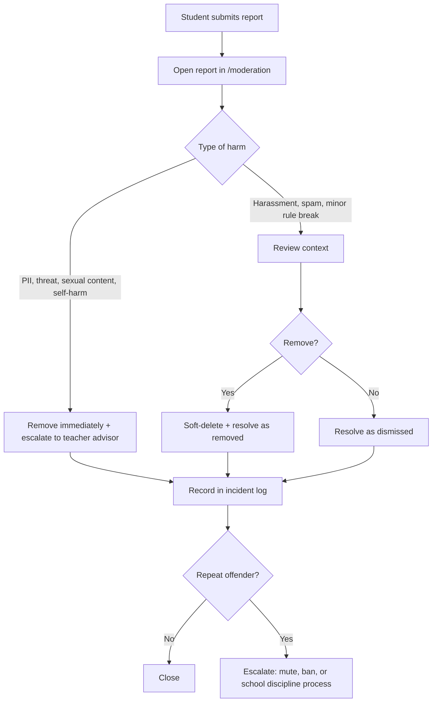

# 安全とモデレーション

> 日本語版です。英語版が正本です: [English](../06-safety-and-moderation.md)
>
> この文書は実務のための方針であり、法的助言ではありません。公開前に、担当教員と学校の管理職が内容を確認してください。日本の法律に触れた箇所は、現行の要件を学校の法務担当に確認してください。

## 1. この文書が必要な理由

利用者の大半は未成年です。学校が運営する掲示板は、中立な立場で片手間にできるプロジェクトではありません。学校の名前を背負い、学校の端末からも開け、いじめや名誉毀損、個人情報の事故の場になり得ます。「問題が起きたら、そのときモデレーションする」という構えの先にあるのは、危機です。

このプロジェクトのルールは一つです。**安全の機能を、成長の機能より先に公開する。**

## 2. 定義

**個人情報（PII）。** 特定の個人を識別できる情報、または他の情報と組み合わせれば合理的に識別できる情報を指します。判断の基準は「合理的な識別可能性」であり、氏名が書かれているかどうかではありません。

| 個人情報に当たるか | 例 | 理由 |
| --- | --- | --- |
| 当たる | 氏名、学籍番号、クラスと姓の組み合わせ | 直接の識別子 |
| 当たる | 氏名のない顔写真 | 生体情報による識別子 |
| 当たる | 電話番号、メールアドレス、LINE ID、SNS のアカウント | 連絡先の識別子 |
| 当たる | 自宅の住所、最寄り駅、毎日の通学経路 | 居場所の特定につながる |
| 当たる | 「写真部で唯一車を運転する 3 年生」 | 消去法による特定 |
| 通常は当たらない | 他の情報を伴わないユーザー名 `sakura_17` | 仮名。ただしアカウント情報として保護する |
| 当たらない | 「化学の先生」 | 特定の個人ではない。ただし学校に 1 人しかいなければ特定につながる |

**モデレーター。** `MODERATOR` ロールを持つ生徒または教職員です。投稿の削除、スレッドのロック、通報の処理が認められています。

**担当教員（teacher advisor）。** 学校が雇用し、サイトの運営に責任を負う成人で、氏名を明らかにしている人です。重大な事案のエスカレーション先でもあります。公開前に必ず定めます。

**削除（論理削除）。** 投稿の本文は監査のためにデータベースへ残し、画面には「モデレーターが削除しました」と表示します。データベースにアクセスできる管理者であれば元に戻せます。

**エスカレーション。** 事案を担当教員に引き継ぐことです。差し迫った危険があるときは、警察や救急へ引き継ぎます。

## 3. 投稿ポリシー

### 禁止 — 見つけ次第削除

1. 生徒、教員、家族の個人情報。氏名、顔、連絡先、住所、特定につながる組み合わせを含みます。
2. 嫌がらせ、特定の個人への侮辱、組織的な嘲笑。
3. 名誉毀損。人についての虚偽で、相手を傷つける事実の主張。
4. 暴力の脅迫、自傷や自殺を促す行為。
5. 性的な内容、性的な画像、人（とくに未成年）についての性的な発言。
6. 個人情報の晒し（doxxing）、つきまとい、予定や居場所の共有。
7. 生徒、教員、学校へのなりすまし。
8. 違法行為。薬物の使用、武器、盗品の共有を含みます。
9. 試験の解答、流出した問題用紙、評価の公正さを損なう内容。
10. スパム、フィッシングのリンク、マルウェア、学校生活と関係のない広告。
11. 著作権侵害。許可のない記事の転載、教科書のスキャン、画像のコピー。

### 歓迎する投稿

- 授業に関する質問。答えられるだけの前提を添えてください。
- 部活動の告知、行事の参加申込、活動報告。
- 持ち主を特定する情報を含まない、落とし物・拾い物の連絡。
- サイト、授業、学校行事についての建設的な意見。
- 人を攻撃せずに書かれた、考え方の相違。
- 学校の常識ある人が嫌がらせと受け取らないユーモア。

### 判断に迷う場合

次のように自問してください。*名前を出された本人が、これを玄関の掲示板に貼られても平気か。* 平気でないなら投稿しません。迷ったモデレーターは、推測で消さずに、投稿を残したまま担当教員へエスカレーションします。消しすぎれば「ここは自分たちの場所ではない」と教えることになります。消す量が少なすぎれば、害が生まれます。

## 4. 利用者のための個人情報ルール

- 本名ではなくユーザー名を使ってください。他人の本名を尋ねないでください。
- 人の写真は投稿しないでください。建物や行事の写真は、顔や名札が写っていない場合に限り投稿できます。
- チャット、成績、学校システムのスクリーンショットは投稿しないでください。
- 自分の情報を投稿されたら、返信で情報を足さずに通報してください。
- 自分の情報が緊急を要する形で出ている場合は、モデレーターか担当教員に直接連絡してください。

## 5. 通報と対応

### 生徒への約束

> 通報はモデレーターが確認します。ほとんどの通報は、学校がある日のうちに対応します。自分や他の人が差し迫った危険にあるときは、教員に伝えるか、救急へ通報してください。このサイトは 24 時間監視されていません。

### 対応の流れ

### 対応の目安

| 深刻度 | 例 | 目標 |
| --- | --- | --- |
| 緊急 | 暴力の脅迫、未成年が関わる性的な内容、進行中の晒し | 直ちに削除する。学校がある日の日中なら 30 分以内に担当教員へ連絡する |
| 高 | 個人情報、的を絞った嫌がらせ、自傷に関する内容 | 学校がある日の当日中 |
| 通常 | スパム、無礼な物言い、話題から外れた投稿 | 学校がある日のうち 2 日以内 |
| 低 | ルールについての意見、機能の要望 | 週に一度まとめて確認する |

### 証拠の保全

緊急度の高い内容を削除する前に、スクリーンショットかデータベースの行への参照を事故記録に残してください。内容をグループチャットへ転送しないでください。害が広がります。共有先は、承認された経路を使った担当教員だけに限ります。

### 自動の要注意語フラグ

投稿とタイトルは保存時に、CC BY 4.0 の `naughty-words` にある日本語・英語の語彙と照合します。学校で普通に使う語は除外リストで外し、日本語の脅迫語を少し足しています。一致すると、`source = AUTO` の `Report` が 1 件、一致語付きでモデレーションキューに入ります。投稿を隠したり、拒否したり、書き換えたりはしません。有罪判定でもありません。

モデレーターは自動フラグを手がかりとして扱い、判定にはしません。誤検出は却下し、本当の脅迫は下の手順でエスカレーションします。語彙は `node_modules/naughty-words` にあり、利用者のデータではありません。投稿内容を外部へ送ることもありません。

## 6. 役割と職務分離

| 役割 | できること | できないこと |
| --- | --- | --- |
| 生徒 | 閲覧、投稿、返信、通報 | モデレーション、通報の閲覧 |
| モデレーター | 投稿・スレッドの削除、スレッドのロック、通報の処理、生徒アカウントの停止 | モデレーターや管理者の停止、ロールの変更、データベースの閲覧、他人のメールの閲覧 |
| 管理者／保守担当 | モデレーターの権限すべてに加え、ロールの変更、モデレーターの停止、ボードのアーカイブ、データベースへのアクセスと配備 | 重大な事案で担当教員を経ずに行動すること |
| 担当教員 | 監督、エスカレーション、方針変更の承認 | 日常の通報対応（本人が手伝うと決めた場合を除く） |

ルールは次のとおりです。

- 公開前に、少なくともモデレーター 2 人と担当教員 1 人をそろえておきます。
- 保守担当が唯一のモデレーターになってはいけません。データベースへのアクセスと、誰のチェックも受けないモデレーション権限を 1 人で兼ねるのは、説明責任の穴です。
- モデレーターは、自分が個人的に関わっているスレッドの処理をしません。別のモデレーターが担当します。
- 永久の利用禁止、警察への相談、対外的な声明といった重大な判断には、担当教員を関わらせます。

### アカウント停止（実装済みの処分）

モデレーターは `/admin?tab=users` から生徒アカウントを停止でき、管理者はモデレーターも停止できます。管理者は停止できず、自分のアカウントも対象外です。停止すると、

- そのアカウントは全端末でログアウトされます（`Session` の行をすべて削除）。以後のログインは `error=suspended` で拒否されます。
- 投稿とスレッドはそのまま残ります。何が起きたかの記録は読める状態を保ちます。
- 入力した理由はアカウントと監査行の両方に残ります。

解除すると停止の記録は消え、またログインできるようになります。停止は元に戻せることを前提にした処分です。アカウントそのものを消す機能はありません。

## 7. 対応の段階

1. **何もしない** — `dismissed` として処理します。善意の通報だった場合は、理由を残します。
2. **削除** — 禁止内容に対する既定の対応です。プレースホルダーは表示されたまま残ります。
3. **スレッドのロック** — 議論が生産的でないものの、内容は削除できない場合に行います。
4. **停止** — 実装済みで、元に戻せます。対象は 1 アカウントずつです。投稿は消したのに書き込みが続くときに使い、理由を書いておくと次のモデレーターが判断できます。
5. **永久の利用禁止**（将来）— 管理者と担当教員の合意が必要です。証拠とともに記録します。現状でこれに最も近いのは、誰も解除しない停止です。
6. **学校の手続き** — いじめ、脅迫、繰り返しの違反は、学校の生徒指導の手続きに引き継ぎます。サイトは懲戒の主体ではありません。

スレッド上で利用者と言い争わないでください。ルールは一度だけ伝え、話し合いは非公開の経路へ移します。記録はそのまま残します。

## 8. 危機対応プロトコル

内容が誰かの **差し迫った危険**（自殺、自傷、暴力、虐待）を示しているときは、次のように動きます。

1. 掲示板を通じてカウンセリングしようとしないでください。
2. メールだけでなく、電話か対面で、直ちに担当教員へ知らせてください。
3. 本人に差し迫った危険があり、担当教員に連絡が取れないときは、救急へ通報してください（日本では警察 110、救急・消防 119）。
4. 内容とメタデータを保全し、担当教員の指示があるまで削除しないでください。
5. 秘密を約束しないでください。次のように伝えます。「心配しています。助けてくれる先生に伝えます。」
6. 何が、いつ、誰に引き継がれたかを記録してください。

掲示板の投稿は相談窓口の代わりにはなりません。地域の支援窓口へのリンクをルールページに掲載し、常に最新に保ってください。

## 9. 日本の法制度（要約であり、助言ではありません）

| 法律・規則 | 関係 |
| --- | --- |
| 個人情報保護法（Act on the Protection of Personal Information） | 学校は生徒のデータを扱います。集めるのは最小限にとどめ、アクセスを制限し、保存期間を定め、開示請求に対応します |
| プロバイダ責任制限法（Provider Liability Limitation Act） | 削除と発信者情報開示の手続きを定めています。運営者には連絡先と対応手順が求められることがあります |
| 刑法 230 条（名誉毀損）・231 条（侮辱） | 投稿は投稿者の刑事責任につながることがあります。対応を怠った運営者にも及ぶ場合があります |
| 著作権法（Copyright Act） | 教科書のスキャン、漫画、転載記事を置いてはいけません |
| 青少年インターネット環境整備法（Act on Development of an Environment Providing Safe Internet Use for Youth） | 未成年のインターネット利用について、学校と運営者が負う責任を定めています |
| 校則・生徒指導方針 | 法律より厳しいことがあります。解釈は担当教員が行います |

実務上は、次の点が重要です。

- 登録時に利用規約への明示的な同意を求め、同意した時刻と版を記録します。この記録は同意の証拠なので残してください。
- 削除の手順と、氏名の分かる連絡先を文書で用意します。
- 適法な照会に応じられる期間はログを保存しますが、必要以上に長くは持ちません。
- 実現できない匿名性は約束しません。アカウント情報やサーバーログは開示の対象になり得ます。
- 警察や学校からの依頼には、担当教員と管理職を関わらせます。自分だけでデータを渡さないでください。

## 9.1 自動フラグの扱い

自動フラグは生徒の通報と同じキューに入ります。`AUTO` と表示され、一致した語も見えます。モデレーターは却下するか投稿を削除するかを選び、どちらも監査ログに残ります。健康や生物の語彙では誤検出が起こり得ます。語彙をその場で削るのではなく、変更を記録し、実際の投稿で試してから調整してください。

## 10. データの保護

- 収集する: ユーザー名、任意のメールアドレス、パスワードハッシュ、投稿、時刻、セッションハッシュ。
- 収集しない: 本名、学年、クラス、誕生日、写真、位置情報、IP アドレス（v0.1 では保存しません。レート制限のために追加する場合は、文書化したうえで保存期間を短くします）。
- アクセス: データベースへのアクセスは、保守担当と、必要に応じて教員が承認した管理者 1 人に限ります。パスワードの共有は禁止です。
- バックアップは、ホストが対応していれば保存時に暗号化し、サーバーとは別の場所に置き、本番データと同じ予定で削除します。
- 漏えい時は、封じ込め、影響の評価、担当教員と管理職への連絡、全セッションのリセット、認証情報の更新、学校の事故対応手順の遵守を、この順で進めます。

## 11. モデレーター向け導入チェックリスト

- [ ] この文書とコミュニティルールのページを読んだ。
- [ ] 「自分が嫌い」と「方針違反」の違いを説明できる。
- [ ] テストアカウントで通報キューを練習した（削除、却下、ロック）。
- [ ] エスカレーション先と危機対応プロトコルを把握している。
- [ ] 通報の内容をモデレーションチームの外へ出さないことに同意した。
- [ ] 休み方を知っている。モデレーターも生徒である。

## 12. 見直し

各学期の始めと、重大な事案のあとにこの方針を見直します。変更は、日付と理由を添えて意思決定ログに記録します。
