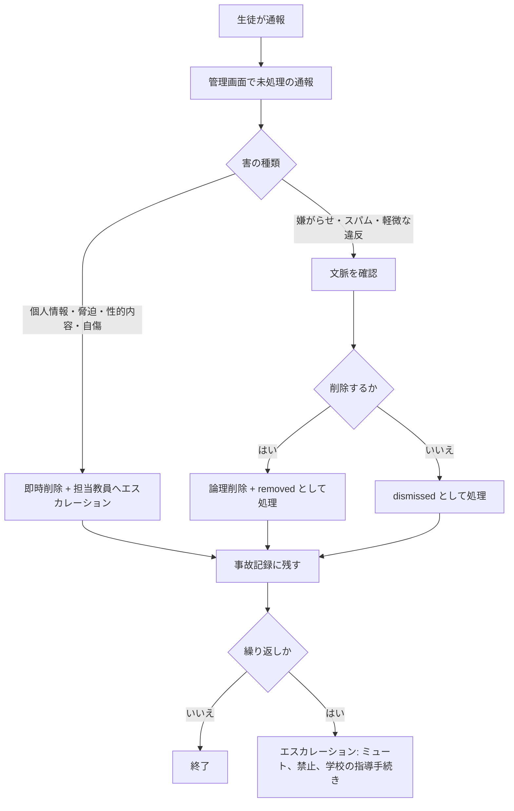

# 安全とモデレーション

> 日本語版です。英語版が正本です: [English](../06-safety-and-moderation.md)
>
> この文書は実務のための方針であり、法的助言ではありません。公開前に、担当教員と学校の管理職が必ず確認してください。日本の法律に触れている箇所は、最新の要件を学校の法務担当に確認してください。

## 1. この文書が必要な理由

利用者の大半は未成年です。学校が運営する掲示板は、中立な片手間のプロジェクトではありません。学校の名前を背負い、学校の端末から到達でき、いじめ、名誉毀損、個人情報の事故の場になり得ます。「問題が出たらモデレーションする」という既定の結果は、危機です。

このプロジェクトのルールは **安全の機能を、成長の機能より先に出す** ことです。

## 2. 定義

**個人情報（PII）。** 特定の個人を識別する情報、または他の入手可能な情報と組み合わせると合理的に識別できる情報。判定基準は「合理的な識別可能性」であり、名前に限りません。

| 個人情報か | 例 | 理由 |
| --- | --- | --- |
| はい | 氏名、学籍番号、クラス + 姓 | 直接的な識別子 |
| はい | 名前のない顔写真 | 生体識別子 |
| はい | 電話番号、メール、LINE ID、SNS アカウント | 連絡先の識別子 |
| はい | 自宅住所、最寄り駅、毎日の通学経路 | 居場所の特定 |
| はい | 「写真部で唯一車を運転する 3 年生」 | 消去法での特定 |
| 通常はいいえ | 他の情報のないユーザー名 `sakura_17` | 仮名。ただしアカウント情報として保護される |
| いいえ | 「化学の先生」 | 学校に 1 人しかいなければ特定の人になる |

**モデレーター。** `MODERATOR` ロールを持つ生徒または教職員。投稿の削除、スレッドのロック、通報の処理が認められている。

**担当教員（teacher advisor）。** 学校に雇用され、サイトの運営に責任を持つ、名前の分かる大人。重大な事件のエスカレーション先。公開前に必要。

**削除（論理削除）。** 監査のために投稿の本文はデータベースに残すが、画面には「Removed by a moderator」と表示する。データベースにアクセスできる管理者は元に戻せる。

**エスカレーション。** 事案を担当教員に渡すこと。差し迫った危険がある場合は、警察または救急に渡すこと。

## 3. 投稿ポリシー

### 禁止 — 見つけ次第削除

1. 生徒、教員、家族の個人情報。氏名、顔、連絡先、住所、特定につながる組み合わせを含む。
2. 嫌がらせ、個人への侮辱、組織的な嘲笑。
3. 名誉毀損: 人についての虚偽で有害な事実の主張。
4. 暴力の脅迫、自傷や自殺の助長。
5. 性的内容、性的な画像、人（特に未成年）についての性的な発言。
6. 個人情報の晒し（doxxing）、つきまとい、予定や居場所の共有。
7. 生徒、教員、学校へのなりすまし。
8. 違法行為。薬物使用、武器、盗品の共有を含む。
9. 試験の解答、流出した問題用紙、評価の公正さを損なう内容。
10. スパム、フィッシングリンク、マルウェア、学校生活と無関係な広告。
11. 著作権侵害: 許可のない記事の転載、教科書のスキャン、画像のコピー。

### 許可され、推奨されるもの

- 授業に関する質問。答えられるだけの文脈を添える。
- 部活動の告知、行事の参加申込、活動報告。
- 持ち主を特定する情報を含まない落とし物・拾い物の連絡。
- サイト、授業、学校行事についての建設的な意見。
- 人を攻撃せずに表現された、考え方の相違。
- 学校の良識ある人が嫌がらせと受け取らないユーモア。

### 判断が難しい場合

自問してください: *名前を出された本人が、これを玄関の掲示板に貼られても平気か。* 平気でないなら投稿しない。迷ったモデレーターは、推測で消さずに投稿を残して担当教員へエスカレーションします。消しすぎると「ここは自分たちの場所ではない」と教えることになり、消さなすぎると害が生まれます。

## 4. 利用者のための個人情報ルール

- 本名ではなくユーザー名を使う。他人の本名を聞かない。
- 人の写真を投稿しない。建物や行事の写真は、顔や名札が写っていない場合に限り許可する。
- チャット、成績、学校システムのスクリーンショットを投稿しない。
- 自分の情報を投稿されたら、返信で追加情報を出さず、通報を使う。
- 自分の情報が緊急を要する形で出ている場合は、モデレーターか担当教員に直接連絡する。

## 5. 通報と対応

### 生徒への約束

> 通報はモデレーターが確認します。ほとんどの通報は学校がある日のうちに対応します。自分や他の人が差し迫った危険にある場合は、教員に連絡するか、救急に通報してください。このサイトは 24 時間監視されていません。

### 流れ

### 対応目標

| 深刻度 | 例 | 目標 |
| --- | --- | --- |
| 緊急 | 暴力の脅迫、未成年が関わる性的内容、進行中の晒し | 直ちに削除。学校がある時間帯なら 30 分以内に担当教員へ連絡 |
| 高 | 個人情報、的を絞った嫌がらせ、自傷に関する内容 | 同じ学校日のうち |
| 通常 | スパム、無礼、脱線 | 学校がある日 2 日以内 |
| 低 | ルールについての意見、機能の要望 | 週次で確認 |

### 証拠

緊急度の高い内容を削除する前に、スクリーンショットかデータベースの行への参照を事故記録に残します。内容をグループチャットへ転送しないでください。害が広がります。共有は、承認された経路で担当教員に限ります。

## 6. 役割と職務分離

| 役割 | できること | できないこと |
| --- | --- | --- |
| 生徒 | 読む、投稿する、返信する、通報する | モデレーション、通報の閲覧 |
| モデレーター | 投稿・スレッドの削除、スレッドのロック、通報の処理 | ロールの変更、データベースの閲覧、他人のメールの閲覧 |
| 管理者／保守担当 | モデレーターの全権限に加え、データベースと配備 | 重大な事件で担当教員を飛ばして行動する |
| 担当教員 | 監督、エスカレーション、方針変更の承認 | 日常のキュー（本人が手伝うと決めた場合を除く） |

ルール:

- 公開前に、少なくともモデレーター 2 人と担当教員 1 人を用意する。
- 保守担当が唯一のモデレーターであってはならない。データベースへのアクセスと無制限のモデレーション権限を 1 人が持つのは、説明責任の穴です。
- モデレーターは、自分が個人的に関わっているスレッドを自分で処理しない。別のモデレーターが担当する。
- 重大な判断（禁止、警察への相談、対外的な声明）には担当教員が関わる。

## 7. 対応の段階

1. **何もしない** — `dismissed` として処理。善意の通報だった場合は理由を残す。
2. **削除** — 禁止内容の既定の対応。プレースホルダーは表示されたまま残る。
3. **スレッドのロック** — 議論が実りないが、内容は削除できない場合。
4. **ミュート**（将来）— 理由と期限を付けて期間を限定する。
5. **禁止**（将来）— 管理者と担当教員の合意が必要。証拠とともに記録する。
6. **学校の手続き** — いじめ、脅迫、繰り返しの違反は、学校の生徒指導の手続きに渡す。サイトは懲戒の主体ではない。

スレッド上で利用者と言い争わないこと。ルールを一度伝え、話し合いを非公開の経路へ移し、記録を残します。

## 8. 危機対応プロトコル

内容が誰かの **差し迫った危険**（自殺、自傷、暴力、虐待）を示している場合:

1. 掲示板を通じてカウンセリングしようとしない。
2. メールだけでなく、電話か対面で直ちに担当教員へ知らせる。
3. 本人に差し迫った危険があり、担当教員に連絡が取れない場合は、救急へ通報する（日本では警察 110、救急・消防 119）。
4. 内容とメタデータを保全する。担当教員の指示があるまで削除しない。
5. 秘密を約束しない。「心配しています。助けられる先生に伝えます」と伝える。
6. 何が、いつ、誰にエスカレーションされたかを記録する。

掲示板の投稿は相談窓口ではありません。地域の支援窓口へのリンクをルールページに掲載し、最新に保ってください。

## 9. 日本の法制度の文脈（要約であり、助言ではない）

| 法律・規則 | 関係 |
| --- | --- |
| 個人情報保護法 | 学校は生徒のデータを扱う。最小限を集め、アクセスを制限し、保存期間を定め、開示請求に対応する |
| プロバイダ責任制限法 | 削除と発信者情報開示の手続きを定める。運営者には連絡先と対応手順が必要になる場合がある |
| 刑法 230 条（名誉毀損）・231 条（侮辱） | 投稿は投稿者の刑事責任を生み得る。場合によっては、対応を怠った運営者にも及ぶ |
| 著作権法 | 教科書のスキャン、漫画、転載記事を置かない |
| 青少年インターネット環境整備法 | 未成年のインターネット利用に関する学校と運営者の責任 |
| 校則・生徒指導方針 | 法律より厳しい場合がある。解釈は担当教員が行う |

実務上の意味:

- 削除の手順と、名前の分かる連絡先を文書化して持つ。
- 適法な照会に応えられる期間はログを保存するが、必要以上に長く持たない。
- 実現できない匿名性を約束しない。アカウント情報やサーバーログは開示対象になり得る。
- 警察や学校からの依頼は、担当教員と管理職を巻き込む。自分だけでデータを渡さない。

## 10. データの保護

- 収集する: ユーザー名、任意のメール、パスワードハッシュ、投稿、時刻、セッションハッシュ。
- 収集しない: 本名、学年、クラス、誕生日、写真、位置情報、IP アドレス（v0.1 では保存しない。レート制限のために追加するなら、文書化して保存期間を短くする）。
- アクセス: データベースへのアクセスは保守担当と、必要なら教員が承認した管理者 1 人に限る。パスワードの共有は禁止。
- バックアップは、ホストが対応する場合は保存時に暗号化し、サーバーとは別の場所に置き、本番データと同じ予定で削除する。
- 漏えい対応: 封じ込め、評価、担当教員と管理職への連絡、全セッションのリセット、認証情報の更新、学校の事故対応手順の遵守。

## 11. モデレーター導入チェックリスト

- [ ] この文書とコミュニティルールのページを読んだ。
- [ ] 「自分が嫌い」と「方針違反」の違いを理解した。
- [ ] テストアカウントでキューを練習した: 削除、却下、ロック。
- [ ] エスカレーション先と危機対応プロトコルを知っている。
- [ ] 通報の内容をモデレーションチームの外へ共有しないことに同意した。
- [ ] 休み方を知っている。モデレーターも生徒である。

## 12. 見直し

各学期の始めと、重大な事故の後にこの方針を見直します。変更は日付と理由を添えて意思決定ログに記録します。
